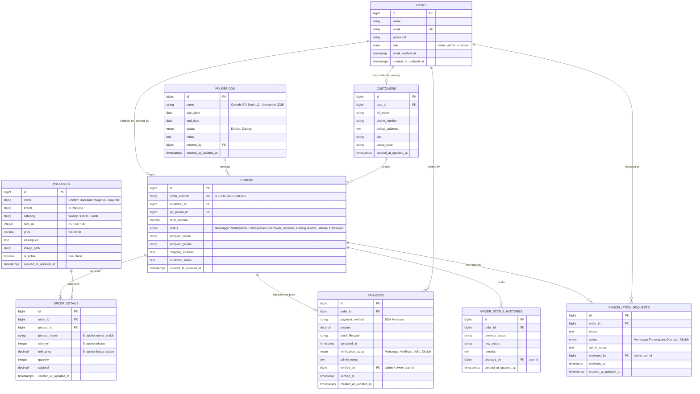

# DATABASE DESIGN SPECIFICATION
## Sistem Informasi Pengelolaan Pre-Order Parfum Berbasis Web - Uyuy Jastip

---

### 1. Entitas Utama Berdasarkan Dokumen Proposal
Berdasarkan Dokumen Proposal Capstone Bab II dan Bab III (Subbab 2.2.4 & 3.3), sistem memiliki 7 entitas utama:
1. **Customer**: Menyimpan data identitas pelanggan yang melakukan registrasi dan pemesanan.
2. **Product**: Menyimpan katalog parfum jastip (*In Parfume*).
3. **PO Period**: Menyimpan siklus pre-order yang dibuka dan ditutup oleh Owner.
4. **Order**: Menyimpan transaksi pemesanan yang dibuat oleh Customer dalam suatu periode PO aktif.
5. **Order Detail**: Menyimpan rincian item parfum dan kuantitas dalam satu Order (multi-item support).
6. **Payment**: Menyimpan informasi pembayaran via BCA Merchant dan file bukti transfer yang diverifikasi Admin.
7. **Order Status**: Menyimpan definisi dan tahapan status pesanan yang baku.

#### Tabel Pendukung Teknis (Technical Supporting Tables)
Untuk mendukung integritas, keamanan, dan fungsionalitas sistem sesuai Laravel best practices:
- **`users`**: Tabel otentikasi login, password hash, dan penentuan role (`customer`, `admin`, `owner`). Terhubung 1-to-1 dengan tabel `customers` untuk user ber-role customer.
- **`order_status_histories`**: Audit log setiap perubahan status pesanan lengkap dengan timestamp dan pencatat perubahan (FR-19).
- **`cancellation_requests`**: Entitas khusus penanganan permohonan pembatalan oleh Customer beserta keputusan Admin (FR-14, FR-15).

---

### 2. Entity Relationship Diagram (Mermaid)

---

### 3. Rincian Kamus Data (Data Dictionary)

#### A. Tabel `users`
- `id` (BIGINT, PK, Auto Increment)
- `name` (VARCHAR 255): Nama pengguna.
- `email` (VARCHAR 255, Unique): Alamat email untuk login.
- `password` (VARCHAR 255): Password hash bcrypt.
- `role` (ENUM: `'owner'`, `'admin'`, `'customer'`): Hak akses sistem.
- `remember_token` (VARCHAR 100, Nullable).
- `created_at`, `updated_at` (TIMESTAMP).

#### B. Tabel `customers`
- `id` (BIGINT, PK, Auto Increment)
- `user_id` (BIGINT, FK ke `users.id`, On Delete Cascade): Akun pengguna terkait.
- `full_name` (VARCHAR 255): Nama lengkap pelanggan.
- `phone_number` (VARCHAR 30): Nomor WhatsApp / Telepon aktif.
- `default_address` (TEXT): Alamat pengiriman lengkap.
- `city` (VARCHAR 100, Nullable): Kota/Kabupaten.
- `postal_code` (VARCHAR 10, Nullable): Kode pos.
- `created_at`, `updated_at` (TIMESTAMP).

#### C. Tabel `po_periods`
- `id` (BIGINT, PK, Auto Increment)
- `name` (VARCHAR 255): Nama periode PO (misal: "PO Batch 10 - Pekan 1").
- `start_date` (DATE): Tanggal mulai pembukaan PO.
- `end_date` (DATE): Tanggal akhir periode PO.
- `status` (ENUM: `'Dibuka'`, `'Ditutup'`): Status operasional PO.
- `notes` (TEXT, Nullable): Keterangan khusus periode PO dari Owner.
- `created_by` (BIGINT, FK ke `users.id`): Owner yang membuat periode PO.
- `created_at`, `updated_at` (TIMESTAMP).

#### D. Tabel `products`
- `id` (BIGINT, PK, Auto Increment)
- `name` (VARCHAR 255): Nama varian parfum.
- `brand` (VARCHAR 100, Default: `'In Parfume'`): Merek/Vendor parfum.
- `category` (VARCHAR 100, Nullable): Kategori aroma (Floral, Woody, Oriental, Fresh, Unisex, dsb).
- `size_ml` (INTEGER): Ukuran botol dalam mililiter (misal: 35, 60, 100).
- `price` (DECIMAL 12,2): Harga per botol (Rp).
- `description` (TEXT, Nullable): Catatan aroma (top/middle/base notes) & deskripsi.
- `image_path` (VARCHAR 255, Nullable): Lokasi berkas foto produk.
- `is_active` (BOOLEAN, Default: `true`): Status ketersediaan produk (dikelola Owner).
- `created_at`, `updated_at` (TIMESTAMP).

#### E. Tabel `orders`
- `id` (BIGINT, PK, Auto Increment)
- `order_number` (VARCHAR 64, Unique): Format `UJ-PO{id}-{YYYYMMDD}-{sequence}`.
- `customer_id` (BIGINT, FK ke `customers.id`, On Delete Restrict): Pelanggan pemesan.
- `po_period_id` (BIGINT, FK ke `po_periods.id`, On Delete Restrict): Periode PO tempat pesanan dibuat.
- `total_amount` (DECIMAL 12,2): Total nilai barang pesanan.
- `status` (ENUM: `'Menunggu Pembayaran'`, `'Pembayaran Diverifikasi'`, `'Diproses'`, `'Barang Dikirim'`, `'Selesai'`, `'Dibatalkan'`): Status utama tahapan pesanan.
- `recipient_name` (VARCHAR 255): Nama penerima paket.
- `recipient_phone` (VARCHAR 30): Nomor WhatsApp penerima.
- `shipping_address` (TEXT): Alamat lengkap tujuan pengiriman.
- `customer_notes` (TEXT, Nullable): Catatan khusus pemesan.
- `created_at`, `updated_at` (TIMESTAMP).

#### F. Tabel `order_details`
- `id` (BIGINT, PK, Auto Increment)
- `order_id` (BIGINT, FK ke `orders.id`, On Delete Cascade): Pesanan induk.
- `product_id` (BIGINT, FK ke `products.id`, On Delete Restrict): Produk yang dipesan.
- `product_name` (VARCHAR 255): Menyimpan snapshot nama saat transaksi dibuat.
- `size_ml` (INTEGER): Snapshot ukuran ml saat transaksi.
- `unit_price` (DECIMAL 12,2): Snapshot harga saat transaksi.
- `quantity` (INTEGER): Jumlah item yang dipesan.
- `subtotal` (DECIMAL 12,2): `unit_price * quantity`.
- `created_at`, `updated_at` (TIMESTAMP).

#### G. Tabel `payments`
- `id` (BIGINT, PK, Auto Increment)
- `order_id` (BIGINT, FK ke `orders.id`, On Delete Cascade): Relasi 1-to-1 dengan `orders`.
- `payment_method` (VARCHAR 100, Default: `'BCA Merchant'`): Metode pembayaran operasional.
- `amount` (DECIMAL 12,2): Jumlah yang dibayarkan.
- `proof_file_path` (VARCHAR 255): Path file foto/gambar bukti transfer.
- `uploaded_at` (TIMESTAMP): Waktu unggah berkas (dasar hitungan masa retensi 1 bulan).
- `verification_status` (ENUM: `'Menunggu Verifikasi'`, `'Valid'`, `'Ditolak'`): Status verifikasi manual Admin.
- `admin_notes` (TEXT, Nullable): Catatan verifikasi Admin (alasan jika ditolak).
- `verified_by` (BIGINT, FK ke `users.id`, Nullable): Admin/Owner yang melakukan verifikasi.
- `verified_at` (TIMESTAMP, Nullable): Waktu tindakan verifikasi dilakukan.
- `created_at`, `updated_at` (TIMESTAMP).

#### H. Tabel `order_status_histories`
- `id` (BIGINT, PK, Auto Increment)
- `order_id` (BIGINT, FK ke `orders.id`, On Delete Cascade): Pesanan terkait.
- `previous_status` (VARCHAR 64, Nullable): Status sebelumnya.
- `new_status` (VARCHAR 64): Status baru yang diterapkan.
- `remarks` (TEXT, Nullable): Catatan keterangan perubahan.
- `changed_by` (BIGINT, FK ke `users.id`, Nullable): User yang memperbarui status.
- `created_at`, `updated_at` (TIMESTAMP).

#### I. Tabel `cancellation_requests`
- `id` (BIGINT, PK, Auto Increment)
- `order_id` (BIGINT, FK ke `orders.id`, On Delete Cascade): Pesanan yang diajukan pembatalan.
- `reason` (TEXT): Alasan Customer mengajukan pembatalan pesanan.
- `status` (ENUM: `'Menunggu Persetujuan'`, `'Disetujui'`, `'Ditolak'`): Keputusan Admin.
- `admin_notes` (TEXT, Nullable): Keterangan keputusan dari Admin.
- `reviewed_by` (BIGINT, FK ke `users.id`, Nullable): Admin yang mengambil keputusan.
- `reviewed_at` (TIMESTAMP, Nullable): Waktu pengambilan keputusan.
- `created_at`, `updated_at` (TIMESTAMP).

---

### 4. Integritas Relasi & Aturan Bisnis Basis Data
1. **Pemisahan Kewenangan**:
   - Kolom `po_periods.created_by` hanya dapat diisi oleh user ber-role `'owner'`.
   - Update `po_periods.status` hanya diizinkan untuk user `'owner'`.
   - Kolom `payments.verified_by` dan `cancellation_requests.reviewed_by` mencatat user Admin/Owner yang bertindak secara nyata (audit trail).
2. **Ketergantungan Pesanan**:
   - Penghapusan produk master tidak akan merusak riwayat transaksi karena tabel `order_details` menyimpan snapshot (`product_name`, `size_ml`, `unit_price`).
3. **Data Isolation Customer**:
   - Setiap query pesanan milik customer selalu difilter `WHERE customer_id = ?` dan divalidasi melalui Policy otorisasi backend.

