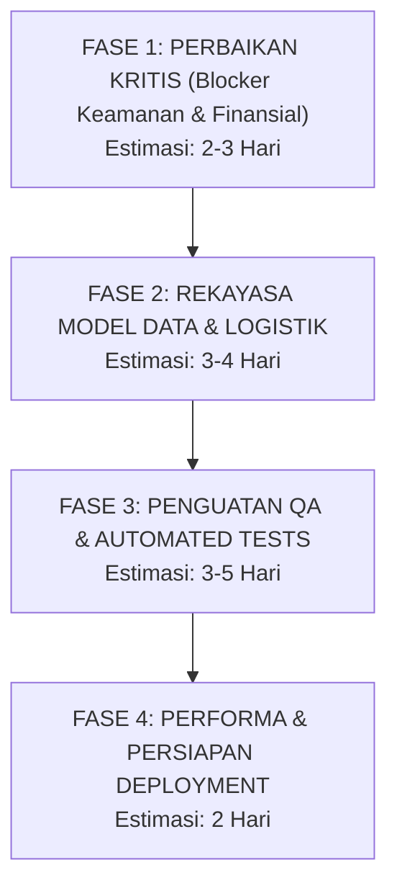

# LAPORAN AUDIT MENYELURUH (COMPREHENSIVE CODEBASE AUDIT)
## Sistem Informasi Pre-Order Parfum — Uyuy Jastip

- **Auditor:** Senior Software & Security Auditor
- **Tanggal Audit:** 10 November 2026
- **Status Evaluasi:** Audit awal dan status remediation per 10 November 2026
- **Target Platform:** Laravel 12 (PHP 8.2), MySQL / MariaDB, Bootstrap 5.3 + CSS Vite lokal
- **Cakupan:** Struktur & Arsitektur, Frontend, Backend/API, Database, Autentikasi & Otorisasi, Keamanan (OWASP), Performa, Error Handling & Logging, Testing, serta Konsistensi Fungsional.

---

## 1. RINGKASAN EKSEKUTIF

> **Pembaruan remediation 10 November 2026:** Rincian temuan di Bagian 2–akhir merekam kondisi awal audit dan rekomendasinya. Jika deskripsi/status historis tersebut bertentangan dengan tabel **Status Penutupan Temuan** di bagian akhir dokumen ini, gunakan tabel dan catatan terbaru. Seluruh 32 temuan sudah ditinjau ulang terhadap kode sesudah perbaikan.

Audit komprehensif dan skeptis dilakukan terhadap berkas kode, rute, migrasi, model, controller, Blade, konfigurasi, serta pengujian **Uyuy Jastip**. Perbaikan setelah audit diterapkan dan diverifikasi melalui tes SQLite, lint PHP, build aset, serta migrasi lokal MySQL setelah backup. Hasil tersebut bukan pengganti uji staging, browser, restore, atau uji penetrasi.

### Status Kesiapan Sistem
- **Kesiapan Sidang Akademik / Demo Prototipe:** **85 / 100**.
- **Kesiapan Rilis Produksi:** **65 / 100 — BELUM SIAP DIRILIS PUBLIK**.
Risiko implementasi utama dari audit awal—harga ukuran yang ditebak, antrean checkout karena lock eksklusif PO, tidak adanya refund, password reset, rate limit register, expiry pembayaran, dan field resi—telah ditangani dalam kode. Rilis publik masih menunggu uji integrasi MySQL/konkurensi yang lebih luas, UAT browser/staging, restore drill, konfigurasi deployment, dan rekonsiliasi data legacy.

### Matriks Temuan Berdasarkan Severity

| Tingkat Keparahan (Severity) | Jumlah Temuan | Status Risiko Utama |
| :--- | :---: | :--- |
| 🔴 **CRITICAL** | **6** | Temuan awal pada kalkulasi varian, transaksi checkout, refund, reset password, rate limit registrasi, dan cakupan test kritis. |
| 🟠 **HIGH** | **9** | Temuan awal pada katalog/demo, edit PO, expiry order, resi/ongkir, modal, disk privat, rekap, dan audit trail. |
| 🟡 **MEDIUM** | **14** | Temuan awal pada policy/controller, validasi/konfigurasi, UI, postal code, keamanan, cache, error handling, script lama, dan retensi. |
| 🟢 **LOW** | **3** | Temuan awal terkait timezone/sosial, security headers/cookie, dan batas jumlah. |
| **TOTAL TEMUAN** | **32** | Status terkini dan bukti penutupan ada di ledger akhir laporan. |

---

## 2. TEMUAN AUDIT PER KATEGORI (10 AREA EVALUASI)

### AREA 1: STRUKTUR & ARSITEKTUR

#### [SEVERITY: MEDIUM] Berkas Otorisasi Yatim Piatu (Orphan File): `OrderPolicy.php` Tidak Pernah Dipakai
- **Lokasi:** `app/Policies/OrderPolicy.php` (Baris 8–37)
- **Deskripsi Masalah:**
  Class `OrderPolicy` telah dibuat lengkap dengan method `view(User $user, Order $order)` dan `interact(User $user, Order $order)`. Namun, class ini tidak pernah didaftarkan di `AppServiceProvider.php`, tidak digunakan via method `$this->authorize()`, `Gate::authorize()`, maupun directive Blade `@can`. Seluruh controller (`Customer\OrderController.php`, `PaymentProofController.php`) menuliskan pengecekan otorisasi manual secara berulang menggunakan kondisional `if ($order->customer_id !== $customer?->id && ...)`.
- **Dampak:**
  Inkonsistensi arsitektur Laravel, duplikasi logika otorisasi, dan risiko kelalaian developer saat menambah endpoint baru yang lupa menyalin pengecekan manual tersebut.
- **Rekomendasi Perbaikan:**
  Daftarkan `OrderPolicy` pada `AuthServiceProvider` / `AppServiceProvider`, lalu refactor seluruh pengecekan di controller menjadi `$this->authorize('view', $order)` dan `$this->authorize('interact', $order)`.
- **Bukti Kode:**
  ```php
  // app/Policies/OrderPolicy.php:13-24
  public function view(User $user, Order $order): bool {
      if ($user->isAdmin() || $user->isOwner()) return true;
      if ($user->isCustomer() && $user->customer) return $order->customer_id === $user->customer->id;
      return false;
  }
  // Tidak ada satupun pemanggilan $this->authorize('view', ...) di seluruh app/Http/Controllers/
  ```

#### [SEVERITY: MEDIUM] Arsitektur Fat Controller Tanpa Form Request dan Service Layer
- **Lokasi:**
  - `app/Http/Controllers/Customer/CartController.php#L152-L330`
  - `app/Http/Controllers/Admin/PaymentController.php#L46-L128`
  - `app/Http/Controllers/Admin/CancellationController.php#L40-L111`
- **Deskripsi Masalah:**
  Controller menangani seluruh tanggung jawab sekaligus: validasi HTTP masukan, manipulasi session, row-locking database, kalkulasi harga berulang, generasi nomor invoice, manipulasi berkas fisik, dan pembuatan status history. Tidak ada class `FormRequest` khusus (semua validasi memakai `$request->validate()` inline), dan tidak ada Action/Service class terpisah.
- **Dampak:**
  Kode sangat sulit diuji secara unit (unit testable), sulit di-maintain jika skala bisnis berkembang, dan meningkatkan kompleksitas siklomatis.
- **Rekomendasi Perbaikan:**
  Ekstrak validasi ke `app/Http/Requests/CheckoutRequest.php`, `RegisterRequest.php`, dan buat domain action terisolasi seperti `App\Actions\CreateOrderAction.php` dan `App\Actions\VerifyPaymentAction.php`.

#### [SEVERITY: MEDIUM] Nilai Rekening Pembayaran BCA Hardcoded di Antarmuka
- **Lokasi:**
  - `resources/views/customer/orders/payment.blade.php#L42`
  - `resources/views/customer/orders/payment.blade.php#L47`
  - `resources/views/customer/orders/payment.blade.php#L153`
- **Deskripsi Masalah:**
  Nomor rekening `8720-1928-33` dan nama pemilik `UYUY JASTIP PARFUM` ditulis secara hardcoded langsung di dalam file Blade dan skrip JavaScript `navigator.clipboard.writeText('8720192833')`. Tidak ada parameter konfigurasi di `.env` maupun tabel pengaturan.
- **Dampak:**
  Jika nomor rekening merchant berubah, pemilik toko harus mengubah kode sumber dan melakukan redeployment aplikasi.
- **Rekomendasi Perbaikan:**
  Pindahkan data rekening ke `config/jastip.php` yang membaca `env('BCA_MERCHANT_ACCOUNT')` dan `env('BCA_MERCHANT_NAME')`, lalu panggil via `config('jastip.bca_account')`.

---

### AREA 2: FRONTEND

#### [SEVERITY: HIGH] Tombol Cepat Akun Demo Admin Mengisi Email yang Salah (Gagal Login)
- **Lokasi:** `resources/views/auth/login.blade.php#L85`
- **Deskripsi Masalah:**
  Pada kartu login demo, tombol cepat Admin memiliki atribut `data-email="admin@uyuy.test"`. Namun, di dalam `database/seeders/DatabaseSeeder.php#L39-L51`, akun admin yang dibuat adalah `admin1@uyuy.test` dan `admin2@uyuy.test`. Email `admin@uyuy.test` tidak ada di database.
- **Dampak:**
  Penguji, dosen penguji, atau calon pengguna yang mengklik tombol demo Admin akan langsung mendapatkan pesan kegagalan otentikasi ("Email atau kata sandi salah").
- **Rekomendasi Perbaikan:**
  Ubah baris 85 menjadi `data-email="admin1@uyuy.test"`.
- **Bukti Kode:**
  ```html
  <!-- resources/views/auth/login.blade.php:85 -->
  <button type="button" class="btn btn-sm demo-pill-btn flex-fill text-center" data-email="admin@uyuy.test" data-role="Admin">
  <!-- database/seeders/DatabaseSeeder.php:41 -->
  'email' => 'admin1@uyuy.test',
  ```

#### [SEVERITY: HIGH] Filter Ukuran Katalog Menyebabkan Produk Hilang (Miskonsepsi Varian)
- **Lokasi:**
  - `app/Http/Controllers/CatalogController.php#L36-L38`
  - `resources/views/pages/catalog.blade.php#L68-L73`
- **Deskripsi Masalah:**
  Dropdown filter ukuran di halaman katalog mengirimkan parameter `size_ml` (35, 60, atau 100). Controller mengeksekusi query:
  `$query->where('size_ml', $validated['size_ml'])`.
  Namun, pada sistem Uyuy Jastip, seluruh produk parfum disimpan dengan nilai default `size_ml = 60`, dan setiap parfum dapat dipesan dalam ukuran 35ml, 60ml, maupun 100ml. Ketika customer memilih filter `35 ml` atau `100 ml`, hampir seluruh produk parfum menghilang dari katalog.
- **Dampak:**
  Pelanggan mengira varian 35ml dan 100ml sedang kosong/tidak tersedia, sehingga potensi konversi penjualan hilang.
- **Rekomendasi Perbaikan:**
  Karena semua parfum mendukung ketiga ukuran via formulasi harga dinamis, hapus filter kolom `size_ml` pada tabel produk, atau ubah menjadi filter ketersediaan jika varian dibuat berbasis tabel relasional tersendiri.

#### [SEVERITY: MEDIUM] Form Checkout Mengunci Permanen Tombol Submit jika Validasi Browser Gagal
- **Lokasi:** `resources/views/customer/cart.blade.php#L230-L238`
- **Deskripsi Masalah:**
  Event listener form checkout langsung menonaktifkan tombol submit saat event `submit` terpanggil:
  ```javascript
  button.dataset.submitting = 'true';
  button.disabled = true;
  button.innerHTML = '<span class="spinner-border spinner-border-sm me-2"></span>Memproses pesanan...';
  ```
  Jika browser membatalkan pengiriman (misal field nomor telepon tidak lolos validasi client, koneksi timeout, atau token CSRF invalid saat dikirim via tab lain), tombol submit tetap berada dalam kondisi `disabled` selamanya tanpa ada mekanisme rollback.
- **Dampak:**
  Pelanggan tidak dapat mengklik tombol checkout kembali dan terpaksa memuat ulang halaman (refresh), yang berisiko mengacaukan input yang sudah diketik.
- **Rekomendasi Perbaikan:**
  Pasang timeout reset atau dengarkan event kegagalan form/validasi untuk mengaktifkan kembali tombol jika form batal dikirim.

#### [SEVERITY: MEDIUM] Kuantitas Item di Keranjang Tidak Dapat Diubah (Hanya Bisa Hapus)
- **Lokasi:** `resources/views/customer/cart.blade.php#L102-L115`
- **Deskripsi Masalah:**
  Pada tabel keranjang belanja, kolom kuantitas hanya berupa teks statis (`{{ $item['quantity'] }}`). Tidak ada input angka, tombol increment (+), atau decrement (-) untuk mengubah jumlah botol. Satu-satunya tombol aksi adalah ikon tong sampah untuk menghapus item seutuhnya.
- **Dampak:**
  Jika pelanggan ingin mengubah pesanan dari 1 botol menjadi 2 botol, mereka terpaksa menghapus item, membuka kembali halaman katalog, mencari produk, dan memasukkan ulang ke keranjang.
- **Rekomendasi Perbaikan:**
  Tambahkan endpoint `POST /pelanggan/keranjang/update/{key}` dan tombol +/- pada tabel keranjang belanja.

#### [SEVERITY: MEDIUM] Double Framework CSS di Antarmuka (Bootstrap 5.3 + Tailwind CDN Runtime)
- **Lokasi:**
  - `resources/views/layouts/app.blade.php#L14-L19`
  - `resources/views/layouts/admin.blade.php#L14-L18`
  - `resources/views/layouts/owner.blade.php#L14-L18`
- **Deskripsi Masalah:**
  Semua berkas layout memuat Bootstrap 5.3 CSS melalui CDN dan sekaligus memuat `<script src="https://cdn.tailwindcss.com"></script>` secara bersamaan. Pemuatan Tailwind CDN di browser klien dilarang resmi oleh dokumentasi Tailwind untuk lingkungan produksi, memicu kompilasi CSS on-the-fly yang berat, meningkatkan Cumulative Layout Shift (CLS), dan menimbulkan konflik utility class.
- **Dampak:**
  Performa render lambat, beban memori browser bertambah, dan website bergantung 100% pada CDN pihak ketiga yang tidak memiliki fallback lokal.
- **Rekomendasi Perbaikan:**
  Kompilasi CSS melalui pipeline Vite (`npm run build`) yang sudah tersedia pada proyek, atau standardisasi antarmuka sepenuhnya menggunakan Bootstrap 5.3 + `uyuy-theme.css`.

#### [SEVERITY: LOW] Tautan Kanal Media Sosial di Footer Bersifat Placeholder (Dead Link)
- **Lokasi:** `resources/views/components/footer.blade.php#L49-L60`
- **Deskripsi Masalah:**
  Tombol Instagram, WhatsApp, TikTok, dan Threads mengarah ke URL root domain publik (`https://instagram.com`, `https://wa.me`, `https://tiktok.com`, `https://threads.net`), bukan akun resmi Uyuy Jastip.
- **Dampak:**
  Menurunkan kredibilitas dan keandalan identitas brand pada pengujian pengguna dan pelanggan riil.
- **Rekomendasi Perbaikan:**
  Isi dengan URL akun profil media sosial dan nomor WhatsApp merchant yang sebenarnya.

---

### AREA 3: BACKEND / API

#### [SEVERITY: CRITICAL] Defek Logika Bisnis: Kalkulasi Harga Dinamis Ukuran Parfum Merusak Skema Harga
- **Lokasi:** `app/Models/Product.php` (Baris 47–55)
- **Deskripsi Masalah:**
  Metode `getPriceForSize(int $sizeMl)` mengimplementasikan aturan harga bertingkat (*tier pricing*) hardcoded dengan logika ternary:
  ```php
  public function getPriceForSize(int $sizeMl): float
  {
      return match ($sizeMl) {
          35 => (float) ($this->price >= 110000 ? 85000 : ($this->price >= 90000 ? 65000 : 55000)),
          60 => (float) $this->price,
          100 => (float) ($this->price >= 110000 ? 180000 : ($this->price >= 90000 ? 140000 : 120000)),
          default => throw new \InvalidArgumentException('...'),
      };
  }
  ```
  Logika ini menimbulkan anomali matematis fatal:
  1. Jika Owner memasukkan produk dengan harga dasar Rp 50.000, ukuran **35 ml justru berharga Rp 55.000** (lebih mahal daripada ukuran 60 ml yang Rp 50.000!).
  2. Jika Owner memasukkan produk parfum eksklusif dengan harga dasar Rp 220.000, ukuran **100 ml dipatok Rp 180.000** (jauh lebih murah daripada ukuran 60 ml yang Rp 220.000!).
  3. Ketika Owner menambah/mengubah produk di `Owner/ProductController.php`, form menyediakan pilihan `size_ml` (35, 60, 100) dan `price`. Jika Owner memilih 35 ml dengan harga Rp 55.000, nilai ini disimpan ke `products.price`, dan saat customer memesan ukuran 60 ml, sistem justru menjual 60 ml seharga Rp 55.000.
- **Dampak:**
  Kerugian finansial langsung bagi pemilik usaha, atau pemerasan harga terhadap pelanggan jika memesan ukuran kecil.
- **Rekomendasi Perbaikan:**
  Buat tabel relasi `product_sizes` atau `product_variants` dengan kolom `product_id`, `size_ml`, dan `price` eksplisit yang ditentukan langsung oleh Owner, alih-alih menggunakan formula tebakan di model.

#### [SEVERITY: CRITICAL] Bottleneck & Potensi Deadlock: Serialisasi Seluruh Checkout pada Row Lock PO Period
- **Lokasi:** `app/Http/Controllers/Customer/CartController.php#L196-L208`
- **Deskripsi Masalah:**
  Saat pelanggan melakukan checkout, kontroler mengeksekusi:
  ```php
  $openPeriods = PoPeriod::query()
      ->where('status', PoPeriod::STATUS_OPEN)
      ->whereDate('start_date', '<=', $todayWib)
      ->whereDate('end_date', '>=', $todayWib)
      ->lockForUpdate()
      ->get();
  ```
  Pemanggilan `lockForUpdate()` pada baris `po_periods` yang sama bagi seluruh pelanggan menyebabkan seluruh transaksi checkout di aplikasi mengantre (*exclusive row lock*) pada satu baris data tunggal.
- **Dampak:**
  Jika 50 pelanggan melakukan checkout serentak pada saat pembukaan batch PO (kondisi *war pre-order*), transaksi akan mengalami bottleneck parah, lonjakan latensi, dan eksekusi akan gagal dengan error fatal MySQL: `SQLSTATE[HY000]: General error: 1205 Lock wait timeout exceeded; try restarting transaction`.
- **Rekomendasi Perbaikan:**
  Gunakan pembacaan snapshot normal (`SELECT` tanpa `lockForUpdate()`) untuk validasi tanggal PO, dan terapkan optimis locking atau atomic stock decrement pada level produk jika menggunakan kuota.

#### [SEVERITY: CRITICAL] Pemblokiran Mutlak Approval Pembatalan Tanpa Fitur Pengembalian Dana (Refund)
- **Lokasi:** `app/Http/Controllers/Admin/CancellationController.php#L64-L67`
- **Deskripsi Masalah:**
  Pada method `decide()`, terdapat guard berikut:
  ```php
  if ($decision === CancellationRequest::STATUS_APPROVED
      && $order->status === Order::STATUS_PAYMENT_VERIFIED) {
      return ['error' => 'Persetujuan pembatalan setelah pembayaran diverifikasi ditahan sampai kebijakan refund ditetapkan Owner.'];
  }
  ```
  Di sisi lain, model `Order.php#L81-L87` mengizinkan pelanggan mengajukan pembatalan untuk status `Pembayaran Diverifikasi`. Akibatnya, pelanggan dapat mengajukan permohonan pembatalan, namun Admin **sama sekali tidak dapat menyetujui permohonan tersebut**!
- **Dampak:**
  Pesanan pelanggan yang sudah membayar dan ingin membatalkan pesanan akan tergantung selamanya dalam antrean `Menunggu Persetujuan`. Uang pelanggan tertahan dan admin tidak memiliki alur kerja sistem untuk memproses pembatalan maupun mencatat bukti transfer pengembalian dana (refund ledger).
- **Rekomendasi Perbaikan:**
  Implementasikan modul refund: tambahkan kolom `refund_status`, `refund_proof_path`, dan `refunded_at` pada tabel `cancellation_requests` atau `payments`, serta berikan form kepada Admin/Owner untuk mengunggah bukti refund sebelum pesanan dinyatakan resmi `Dibatalkan`.

#### [SEVERITY: HIGH] Fitur Krusial Hilang: Owner Tidak Dapat Mengedit atau Mengoreksi Periode PO
- **Lokasi:** `app/Http/Controllers/Owner/PoPeriodController.php` (Hanya ada method `index`, `create`, `store`, `toggleStatus`)
- **Deskripsi Masalah:**
  Tidak terdapat route, controller method, maupun view untuk mengedit (`edit`/`update`) atau menghapus (`destroy`) data periode PO yang sudah dibuat.
- **Dampak:**
  Jika Owner melakukan kesalahan pengetikan nama batch, salah memasukkan tanggal mulai, atau salah memasukkan tanggal tutup, Owner **tidak dapat memperbaiki kesalahan tersebut melalui antarmuka**. Satu-satunya cara adalah manipulasi basis data manual oleh developer.
- **Rekomendasi Perbaikan:**
  Tambahkan rute `GET /owner/periode-po/{id}/edit` dan `PUT /owner/periode-po/{id}`, serta lengkapi dengan validasi integritas (misal: tanggal tidak boleh diubah jika sudah ada pesanan masuk yang terikat).

#### [SEVERITY: HIGH] Ketiadaan Mekanisme Expiry Pesanan yang Menunggu Pembayaran
- **Lokasi:** `app/Http/Controllers/Customer/CartController.php#L283`
- **Deskripsi Masalah:**
  Pesanan yang baru dibuat langsung berstatus `Menunggu Pembayaran`. Tidak ada tanggal jatuh tempo (`payment_due_at`), tidak ada scheduler/cron job, dan tidak ada command artisan untuk membatalkan pesanan yang tidak dibayar pelanggan.
- **Dampak:**
  Pesanan tanpa pembayaran dapat menumpuk ribuan record tanpa batas waktu, mengacaukan statistik antrean admin, dan menyulitkan rekapitulasi kebutuhan procurement barang.
- **Rekomendasi Perbaikan:**
  Tambahkan kolom `payment_deadline_at` (misal 24 jam sejak order dibuat) dan buat Scheduled Console Command (`php artisan orders:cancel-expired`) yang berjalan setiap jam di `routes/console.php`.

---

### AREA 4: DATABASE

#### [SEVERITY: HIGH] Struktur Data Tidak Mendukung Resi Pengiriman dan Biaya Ongkos Kirim
- **Lokasi:** `database/migrations/2026_10_30_000004_create_orders_table.php`
- **Deskripsi Masalah:**
  Tabel `orders` hanya mencatat `recipient_name`, `recipient_phone`, `shipping_address`, dan `customer_notes`. Tidak ada kolom untuk:
  - `shipping_cost` (ongkos kirim, bertipe decimal)
  - `courier` (nama ekspedisi, misal JNE, J&T, SiCepat)
  - `tracking_number` (nomor resi pengiriman)
  Saat Admin mengubah status menjadi `Barang Dikirim`, Admin terpaksa mengetik nomor resi ke dalam kolom `order_status_histories.remarks` (`admin/orders/show.blade.php#L67`).
- **Dampak:**
  Data logistik tidak terstruktur. Pelanggan tidak memiliki informasi tracking yang jelas pada kartu pesanannya, dan sistem tidak dapat mengagregasi total biaya pengiriman.
- **Rekomendasi Perbaikan:**
  Buat migrasi baru:
  `ALTER TABLE orders ADD COLUMN courier VARCHAR(50) NULL, ADD COLUMN tracking_number VARCHAR(100) NULL, ADD COLUMN shipping_cost DECIMAL(12,2) DEFAULT 0;`

#### [SEVERITY: HIGH] Skema Database Tidak Menyimpan Harga Beli Modal (*Cost Price*)
- **Lokasi:** `database/migrations/2026_10_30_000003_create_products_table.php`
- **Deskripsi Masalah:**
  Dokumen spesifikasi `SYSTEM_REQUIREMENTS.md` (FR-05 dan FR-17) mengamanatkan sistem menghitung estimasi keuntungan bersih (*profit margin*). Namun tabel `products` hanya memiliki kolom `price` (harga jual titip). Kolom `cost_price` (modal belanja ke toko *In Parfume*) tidak pernah dibuat.
- **Dampak:**
  Modul rekapitulasi Owner (`Owner\RecapController.php`) tidak dapat menghitung keuntungan riil usaha jastip, melainkan hanya menghitung omzet kotor (*gross revenue*).
- **Rekomendasi Perbaikan:**
  Tambahkan kolom `cost_price DECIMAL(12,2) NULL` pada tabel `products` dan sediakan input modal pada form tambah/edit produk Owner.

#### [SEVERITY: MEDIUM] Kolom `postal_code` di Tabel `customers` Tidak Pernah Diisi
- **Lokasi:**
  - `database/migrations/2026_10_30_000001_create_customers_table.php#L21`
  - `app/Http/Controllers/AuthController.php#L70-L100`
- **Deskripsi Masalah:**
  Tabel `customers` mendefinisikan kolom `postal_code VARCHAR(10) NULL`. Namun form registrasi pelanggan (`resources/views/auth/register.blade.php`) dan kontroler otentikasi (`AuthController.php`) tidak pernah meminta, memvalidasi, maupun menyimpan kode pos.
- **Dampak:**
  Kolom database menjadi *dead column* dan kurir ekspedisi berisiko salah mengirim paket karena data kode pos tidak terekam secara terstruktur.
- **Rekomendasi Perbaikan:**
  Tambahkan input kode pos pada form registrasi dan checkout, serta simpan ke profil pelanggan.

#### [SEVERITY: MEDIUM] Ketiadaan Backup Database Terjadwal dan Disaster Recovery Drill
- **Lokasi:** Lingkungan Basis Data (`config/database.php`)
- **Deskripsi Masalah:**
  Tidak ada konfigurasi snapshot atau scheduled backup otomatis untuk basis data MariaDB/MySQL. Perubahan skema sebelumnya hanya mengandalkan backup dump manual satu kali ke folder temp Windows pengembang.
- **Dampak:**
  Jika terjadi kegagalan disk, ransomware, atau kerusakan data pada database production, bisnis akan kehilangan seluruh riwayat transaksi pesanan dan keuangan pelanggan.
- **Rekomendasi Perbaikan:**
  Instal package `spatie/laravel-backup` atau pasang cron job mysqldump harian yang diunggah ke storage offsite (misal S3 terenkripsi).

---

### AREA 5: AUTENTIKASI & OTORISASI

#### [SEVERITY: CRITICAL] Fitur Lupa Password dan Reset Password Sama Sekali Belum Dibuat
- **Lokasi:**
  - `routes/web.php` (Baris 50–54)
  - `app/Http/Controllers/AuthController.php`
- **Deskripsi Masalah:**
  Sistem hanya menyediakan route `/login`, `/register`, dan `/logout`. Tidak ada route `/forgot-password`, tidak ada controller pengirim token reset, tidak ada view form permintaan reset, dan tidak ada email mailable.
- **Dampak:**
  Pelanggan yang lupa kata sandinya akan terkunci permanen dari akunnya, tidak dapat mengakses riwayat pesanan yang sudah dibayar, dan tidak dapat mengunggah bukti transfer.
- **Rekomendasi Perbaikan:**
  Implementasikan alur standar Laravel Password Reset (`Password::sendResetLink()` dan `Password::reset()`) lengkap dengan notifikasi email atau reset via WhatsApp admin.

#### [SEVERITY: CRITICAL] Ketiadaan Rate Limiting pada Endpoint Registrasi Akun Pelanggan
- **Lokasi:** `app/Http/Controllers/AuthController.php` (Method `register()`, Baris 67–109)
- **Deskripsi Masalah:**
  Method `login()` dilindungi oleh `RateLimiter::tooManyAttempts($throttleKey, 5)`. Namun, method `register()` sama sekali **TIDAK memiliki throttling / rate limiting**.
- **Dampak:**
  Bot atau penyerang dapat mengirimkan ribuan request POST serentak ke `/register`, membanjiri tabel `users` dan `customers` dengan akun fiktif, mengonsumsi ID auto-increment, dan melumpuhkan kapasitas server database (*Resource Exhaustion Denial of Service*).
- **Rekomendasi Perbaikan:**
  Terapkan throttle middleware pada rute registrasi di `routes/web.php`:
  `Route::post('/register', [AuthController::class, 'register'])->middleware('throttle:5,1')->name('register.post');`

#### [SEVERITY: MEDIUM] Validasi Nomor Telepon / WhatsApp Sangat Lemah
- **Lokasi:**
  - `app/Http/Controllers/AuthController.php#L72`
  - `app/Http/Controllers/Customer/CartController.php#L183`
- **Deskripsi Masalah:**
  Aturan validasi nomor telepon hanya: `'recipient_phone' => ['required', 'string', 'max:30']`.
  Sistem menerima input string huruf seperti `"nomor-palsu"`, teks negatif, simbol matematika, atau script string pendek.
- **Dampak:**
  Admin tidak dapat menghubungi pelanggan melalui WhatsApp saat melakukan konfirmasi belanja parfum atau saat bukti transfer ditolak.
- **Rekomendasi Perbaikan:**
  Gunakan aturan regex nomor telepon Indonesia:
  `['required', 'string', 'regex:/^(08|62|\+62)[0-9]{8,13}$/']`.

---

### AREA 6: KEAMANAN (SECURITY & OWASP COMPLIANCE)

#### [SEVERITY: HIGH] Disk Privat Lokal Mengaktifkan Fitur `serve => true` Tanpa Kebutuhan
- **Lokasi:** `config/filesystems.php#L36`
- **Deskripsi Masalah:**
  Pada disk `local` (yang menyimpan bukti pembayaran privat di `storage/app/private`), opsi `'serve' => true` diaktifkan:
  ```php
  'local' => [
      'driver' => 'local',
      'root' => storage_path('app/private'),
      'serve' => true,
      'throw' => false,
      'report' => false,
  ],
  ```
  Pada Laravel 11/12, opsi ini otomatis mendaftarkan rute publik `GET /storage/{path}` dan `PUT /storage/{path}` ke framework.
- **Dampak:**
  Membuka attack surface yang tidak perlu pada penanganan file framework, berpotensi memicu bypass tanda tangan relatif jika `APP_KEY` bocor. Aplikasi sendiri sudah memiliki controller khusus yang aman (`PaymentProofController.php`).
- **Rekomendasi Perbaikan:**
  Ubah `'serve' => false` pada disk `local`.

#### [SEVERITY: MEDIUM] Ketiadaan Security Headers Global (CSP, HSTS, X-Frame-Options)
- **Lokasi:** `bootstrap/app.php` (Baris 14–18)
- **Deskripsi Masalah:**
  Aplikasi hanya menerapkan header keamanan (CSP, X-Content-Type-Options) secara parsial pada response berkas bukti di `PaymentProofController.php`. Halaman web utama sama sekali tidak memiliki response header keamanan global seperti `X-Frame-Options: SAMEORIGIN`, `X-Content-Type-Options: nosniff`, `Referrer-Policy: strict-origin-when-cross-origin`, dan `Strict-Transport-Security`.
- **Dampak:**
  Halaman web rentan terhadap serangan Clickjacking (dimasukkan ke dalam `<iframe>` website penyerang) dan serangan MIME-sniffing.
- **Rekomendasi Perbaikan:**
  Buat middleware global `SecurityHeadersMiddleware` atau aktifkan via `bootstrap/app.php`.

#### [SEVERITY: LOW] Konfigurasi Cookie Sesi Belum Mengaktifkan Flag Secure
- **Lokasi:** `config/session.php#L172` dan `.env`
- **Deskripsi Masalah:**
  `SESSION_SECURE_COOKIE` bernilai `null` (default false jika tidak di-set di `.env`).
- **Dampak:**
  Cookie sesi pengguna dapat ditransmisikan melalui protokol HTTP tanpa enkripsi TLS jika aplikasi diakses melalui jaringan publik yang tidak memaksakan HTTPS.
- **Rekomendasi Perbaikan:**
  Pastikan pada lingkungan production `.env` memuat `SESSION_SECURE_COOKIE=true` dan `SESSION_SAME_SITE=lax`.

---

### AREA 7: PERFORMA

#### [SEVERITY: HIGH] Masalah Pemuatan Memori Skala Besar pada Rekapitulasi Belanja Vendor
- **Lokasi:** `app/Http/Controllers/Owner/RecapController.php#L48-L66`
- **Deskripsi Masalah:**
  Kontroler menarik seluruh data `OrderDetail` dari database ke memori PHP menggunakan query Eloquent:
  ```php
  $recapData = OrderDetail::whereIn('order_id', $verifiedOrderIds)
      ->with('product')
      ->get()
      ->groupBy(function ($item) {
          return $item->product_id . '_' . $item->size_ml;
      })
      ->map(function ($items) { ... });
  ```
- **Dampak:**
  Jika dalam satu periode PO terdapat 500 transaksi dengan total 2.500 baris item parfum, kontroler akan menginstansiasi ribuan objek Eloquent ke memori server. Hal ini akan memicu error `Fatal error: Allowed memory size of 134217728 bytes exhausted`.
- **Rekomendasi Perbaikan:**
  Lakukan agregasi langsung pada level mesin SQL menggunakan `GROUP BY`:
  ```php
  OrderDetail::query()
      ->whereIn('order_id', $verifiedOrderIds)
      ->selectRaw('product_name, size_ml, SUM(quantity) as total_quantity, SUM(subtotal) as total_subtotal, COUNT(DISTINCT order_id) as order_count')
      ->groupBy('product_id', 'product_name', 'size_ml')
      ->orderByDesc('total_quantity')
      ->get();
  ```

#### [SEVERITY: MEDIUM] Ketiadaan Caching untuk Query Informasi PO Aktif
- **Lokasi:**
  - `app/Http/Controllers/HomeController.php#L12`
  - `app/Http/Controllers/CatalogController.php#L19`
  - `app/Http/Controllers/ProductDetailController.php#L13`
  - `app/Http/Controllers/Customer/CartController.php#L21`
  - `app/Http/Controllers/Customer/DashboardController.php#L17`
- **Deskripsi Masalah:**
  Query `PoPeriod::active()->first()` dieksekusi secara berulang pada setiap muatan halaman publik dan customer, tanpa pernah disimpan ke dalam cache memori aplikasi.
- **Dampak:**
  Beban query ke database MariaDB meningkat drastis saat terjadi lonjakan traffic pengunjung.
- **Rekomendasi Perbaikan:**
  Gunakan Laravel Cache:
  `Cache::remember('active_po_period', 60, fn () => PoPeriod::active()->first());`
  dan lakukan invalidasi cache (`Cache::forget('active_po_period')`) saat Owner mengubah status PO di `PoPeriodController`.

---

### AREA 8: ERROR HANDLING & LOGGING

#### [SEVERITY: HIGH] Ketiadaan Audit Trail dan Security Logging Terpusat pada Mutasi Finansial
- **Lokasi:**
  - `app/Http/Controllers/Admin/PaymentController.php#L46-L128`
  - `app/Http/Controllers/Admin/CancellationController.php#L40-L111`
  - `app/Http/Controllers/Customer/CartController.php#L152-L330`
- **Deskripsi Masalah:**
  Aplikasi hanya mencatat riwayat perubahan status pada tabel `order_status_histories`. Tidak ada satupun pemanggilan `Log::info()`, `Log::warning()`, atau `Log::error()` saat admin menyetujui pembayaran, menolak bukti transfer, atau saat checkout dibatalkan.
- **Dampak:**
  Jika terjadi sengketa keuangan atau manipulasi data di tingkat database, sistem tidak memiliki file log terpisah (*audit log files*) untuk analisis forensik insiden keamanan.
- **Rekomendasi Perbaikan:**
  Terapkan logging terstruktur:
  `Log::info('Payment verified', ['order_id' => $order->id, 'admin_id' => Auth::id(), 'status' => $newVerificationStatus]);`

#### [SEVERITY: MEDIUM] Silent Rollback dan Pesan Error Kurang Spesifik pada Checkout
- **Lokasi:** `app/Http/Controllers/Customer/CartController.php#L244-L246`
- **Deskripsi Masalah:**
  Jika salah satu produk dalam keranjang telah dinonaktifkan oleh Owner saat pelanggan mengklik tombol bayar, transaksi me-return `null` dan me-redirect dengan pesan umum:
  `"Checkout dibatalkan: periode PO tidak terbuka tunggal atau salah satu produk sudah tidak tersedia. Muat ulang katalog dan keranjang."`
  Sistem tidak memberitahukan produk mana yang habis/nonaktif.
- **Dampak:**
  Pelanggan frustrasi karena tidak mengetahui produk spesifik yang menyebabkan checkout mereka gagal.
- **Rekomendasi Perbaikan:**
  Deteksi produk yang tidak valid secara presisi dan kembalikan pesan eksplisit: `"Produk [Nama Produk] sudah dinonaktifkan dari katalog."`

---

### AREA 9: TESTING & QUALITY ASSURANCE

#### [SEVERITY: CRITICAL] Defisit Pengujian Ekstrem: 90% Fitur Kritis Tidak Memiliki Automated Test
- **Lokasi:** Folder `tests/Feature/` dan `tests/Unit/`
- **Deskripsi Masalah:**
  Satu-satunya berkas pengujian fungsional yang ada di test suite Laravel adalah `tests/Feature/BusinessFlowHardeningTest.php` (hanya berisi 5 test).
  Modul-modul vital berikut **SAMA SEKALI TIDAK MEMILIKI TEST**:
  1. **Autentikasi:** Login gagal, login sukses, rate limiter throttle, registrasi akun baru, keunikan email.
  2. **Keranjang Belanja:** Tambah varian, batasan kuantitas maksimal 50, hapus varian, rekalkulasi subtotal.
  3. **Manajemen Admin:** Pengubahan status fulfillment (Diproses, Dikirim, Selesai), filter pesanan, penolakan bukti bayar dengan catatan.
  4. **Manajemen Owner:** Tambah produk baru, upload foto produk, toggle aktif/nonaktif, buat periode PO, toggle buka/tutup PO.
  5. **Keamanan / IDOR:** Pengujian Customer A mengakses `/pelanggan/pesanan/{id}` milik Customer B, pengujian akses file bukti transfer attempt lintas pengguna.
  6. **Customer Cancellation:** Pengajuan pembatalan dengan alasan valid dan validasi min 5 karakter.
- **Dampak:**
  Regresi kode (bug baru yang merusak fitur lama) dapat terjadi kapan saja tanpa terdeteksi saat developer melakukan update atau refactoring.
- **Rekomendasi Perbaikan:**
  Buat test suite komprehensif minimal 40 skenario pengujian unit & fitur di PHPUnit.

#### [SEVERITY: MEDIUM] Script Pengujian Python Usang dan Kontradiktif dengan Kode Terkini
- **Lokasi:** `run_system_test.py` (Baris 190–191) dan `TESTING_REPORT.md` (Baris 100)
- **Deskripsi Masalah:**
  Pada script Python legacy `run_system_test.py`, baris 191 menguji:
  `check("Owner -> Admin Dashboard (Should be 403)", 403, code)`.
  Padahal pada implementasi rute terkini (`routes/web.php#L92`), rute admin menggunakan middleware `role:admin,owner` sehingga Owner berhak mengakses dashboard admin (menghasilkan status HTTP 200). Script pengujian ini akan langsung **FAIL** jika dijalankan hari ini.
- **Dampak:**
  Dokumen laporan pengujian lama (`TESTING_REPORT.md`) tidak lagi valid dan menyesatkan evaluator.
- **Rekomendasi Perbaikan:**
  Hapus script python usang tersebut dan migrasikan seluruh pengujian ke dalam PHPUnit Feature Tests bawaan Laravel.

---

### AREA 10: KONSISTENSI FUNGSIONAL & LOGIC

#### [SEVERITY: MEDIUM] Inkonsistensi Dokumentasi Proposal vs Implementasi Retensi Bukti Transfer
- **Lokasi:**
  - `SYSTEM_REQUIREMENTS.md` (FR-22 & NFR-11)
  - `OPEN_QUESTIONS.md` (Poin C)
  - `app/Console/Commands/SecurePaymentProofs.php`
- **Deskripsi Masalah:**
  Dokumen proposal capstone secara tegas menyatakan masa retensi bukti pembayaran adalah **maksimal 1 (satu) bulan**. Namun, pada implementasi riil dan dokumen `OPEN_QUESTIONS.md`, diputuskan bahwa bukti transfer lama dipertahankan tanpa batas waktu sampai ada kebijakan resmi Owner. Tidak ada fitur otomatisasi penghapusan (*auto-purge*).
- **Dampak:**
  Kesenjangan (*gap*) antara kriteria penerimaan proposal awal dengan fungsionalitas sistem riil.
- **Rekomendasi Perbaikan:**
  Formalisasikan keputusan bisnis ini ke dalam revisi dokumen kebutuhan, atau bangun cron command `payments:purge-expired-proofs` dengan opsi durasi hari.

#### [SEVERITY: LOW] Inkonsistensi Input Batas Maksimal Jumlah Botol (20 vs 50)
- **Lokasi:**
  - `resources/views/pages/product-detail.blade.php#L153` (`max="20"`)
  - `app/Http/Controllers/Customer/CartController.php#L100` (`'quantity' => ['max:50']`)
  - `app/Http/Controllers/Customer/CartController.php#L117` (`$newQuantity > 50`)
- **Deskripsi Masalah:**
  Di halaman detail produk, input HTML kuantitas membatasi atribut `max="20"`. Namun pada validasi server di `CartController`, batas maksimal adalah 50 botol.
- **Dampak:**
  Inkonsistensi pengalaman pengguna (UX mismatch).
- **Rekomendasi Perbaikan:**
  Samakan nilai batas maksimal kuantitas menjadi 50 botol pada seluruh layer frontend dan backend.

---

## 3. DAFTAR FITUR / FLOW YANG BELUM MEMILIKI TEST

Berikut adalah daftar modul dan alur bisnis penting yang **SAMA SEKALI TIDAK MEMILIKI AUTOMATED TEST** di dalam suite pengujian PHPUnit (`tests/`):

1. **Alur Autentikasi Pengguna:**
   - Registrasi Customer dengan email duplikat (harus ditolak).
   - Registrasi Customer dengan kata sandi kurang dari 8 karakter atau konfirmasi sandi tidak cocok.
   - Throttling login setelah 5 kali percobaan gagal (harus terkunci 60 detik).
   - Pengalihan login berdasarkan peran (Customer ke `/pelanggan/dashboard`, Admin ke `/admin/dashboard`, Owner ke `/owner/dashboard`).
   - Logout mengakhiri sesi dan meregenerasi CSRF token.
2. **Alur Pengelolaan Keranjang Belanja:**
   - Penambahan produk ke keranjang saat PO ditutup (harus ditolak dan redirect dengan flash error).
   - Penambahan produk melebihi 50 botol (harus ditolak).
   - Penghapusan item dari keranjang dan rotasi token idempotency checkout.
3. **Alur Unggah Bukti Pembayaran:**
   - Unggah berkas bukan gambar/PDF (misal `.exe` atau `.php` — harus ditolak oleh validator MIME).
   - Unggah bukti transfer dengan nominal tidak sama dengan total tagihan pesanan (harus ditolak).
   - Pembatalan status bukti lama menjadi `Digantikan` saat customer mengunggah bukti baru (attempt increment).
4. **Alur Otorisasi & Pencegahan IDOR (Insecure Direct Object Reference):**
   - Customer B membuka rute `/pelanggan/pesanan/{id_milik_customer_A}` (harus return 403 Forbidden).
   - Customer B mengunggah pembayaran untuk pesanan milik Customer A (harus ditolak 403).
   - Customer B mengajukan pembatalan untuk pesanan milik Customer A (harus ditolak 403).
   - Customer B mengunduh bukti pembayaran milik Customer A via `/pembayaran/{id}/bukti` (harus 403).
5. **Alur Operasional Admin:**
   - Admin memverifikasi pembayaran menjadi `Valid` (status order harus berubah otomatis menjadi `Pembayaran Diverifikasi`).
   - Admin menolak pembayaran tanpa mengisi catatan alasan penolakan (harus ditolak validasi).
   - Transisi status pesanan tidak berurutan, misal langsung melompat dari `Menunggu Pembayaran` ke `Barang Dikirim` (harus ditolak oleh `nextOperationalStatuses()`).
6. **Alur Manajemen Master Owner:**
   - Penambahan produk baru dengan harga nol atau negatif.
   - Pembuatan periode PO dengan tanggal akhir sebelum tanggal mulai (`end_date < start_date`).
   - Penutupan PO otomatis untuk periode sebelumnya saat periode baru dibuka.
   - Pencarian direktori pelanggan pada `/owner/pelanggan`.

---

## 4. QUICK WINS (PERBAIKAN MUDAH DENGAN DAMPAK BESAR)

Langkah perbaikan berikut dapat diselesaikan dalam waktu singkat (< 1 hari kerja) dengan dampak signifikan terhadap stabilitas sistem:

1. **Koreksi Email Demo Admin pada Halaman Login:**
   - *Lokasi:* `resources/views/auth/login.blade.php:85`
   - *Tindakan:* Ubah `data-email="admin@uyuy.test"` menjadi `data-email="admin1@uyuy.test"`.
   - *Dampak:* Tombol demo langsung berfungsi normal saat presentasi/pengujian.
2. **Pasang Rate Limiting pada Rute Registrasi:**
   - *Lokasi:* `routes/web.php:53`
   - *Tindakan:* Tambahkan `->middleware('throttle:5,1')` pada `Route::post('/register', ...)`.
   - *Dampak:* Menutup celah bot spam pendaftaran akun seketika.
3. **Nonaktifkan Fitur `serve => true` pada Disk Privat Lokal:**
   - *Lokasi:* `config/filesystems.php:36`
   - *Tindakan:* Ubah `'serve' => true` menjadi `'serve' => false`.
   - *Dampak:* Menghilangkan rute upload/serve file lokal bawaan Laravel yang tidak terproteksi.
4. **Pindahkan Nomor Rekening BCA ke Konfigurasi Terpusat:**
   - *Lokasi:* `config/app.php` atau file config baru, lalu panggil di `resources/views/customer/orders/payment.blade.php`.
   - *Dampak:* Nomor rekening merchant dapat diperbarui kapan saja tanpa mengubah kode tampilan.
5. **Perbaiki Regex Validasi Nomor WhatsApp:**
   - *Lokasi:* `AuthController.php` dan `CartController.php`.
   - *Tindakan:* Ganti `'string'` menjadi `'regex:/^(08|62|\+62)[0-9]{8,13}$/'`.
   - *Dampak:* Menjamin nomor telepon penerima valid dan dapat dihubungi via WhatsApp.
6. **Optimasi Query Agregasi SQL pada Rekapitulasi Owner:**
   - *Lokasi:* `app/Http/Controllers/Owner/RecapController.php:48-66`
   - *Tindakan:* Ganti `get()->groupBy()` dengan `selectRaw(...)->groupBy(...)`.
   - *Dampak:* Mengeliminasi risiko out-of-memory pada server saat data pesanan membesar.

---

## 5. REKOMENDASI PRIORITAS PERBAIKAN (ACTION ROADMAP)

Bagian ini adalah roadmap dari audit awal. Status terbaru, pekerjaan yang telah dilaksanakan, dan sisa action plan rilis berada pada Bagian 7 dan 8 di akhir dokumen.

Urutan pengerjaan perbaikan direkomendasikan berdasarkan matriks **Risiko vs Effort**:



### Fase 1: Perbaikan Kritis (Blocker Keamanan, Finansial & Akses)
1. **Refactor Logika Harga Produk (`Product.php`):** Hapus formula ternary hardcoded. Buat skema varian harga per ukuran yang eksplisit.
2. **Bangun Alur Reset Password:** Buat controller dan view lupa kata sandi untuk mencegah penguncian akun customer.
3. **Penyelesaian Alur Pembatalan & Refund:** Tetapkan aturan bisnis apakah order terverifikasi boleh dibatalkan; jika boleh, sediakan form pencatatan refund untuk Admin.
4. **Pencegahan Bottleneck Transaksi Checkout:** Hapus `lockForUpdate()` pada row PO Period di `CartController.php`.

### Fase 2: Rekayasa Model Data & Logistik
1. **Tambahkan Fitur Edit/Update Periode PO:** Lengkapi kontroler `OwnerPoPeriodController` dengan method `edit` dan `update`.
2. **Tambahkan Kolom Resi & Kurir pada Tabel Orders:** Buat migrasi untuk `courier`, `tracking_number`, dan `shipping_cost`, serta sediakan form input saat Admin mengubah status ke `Barang Dikirim`.
3. **Implementasikan Expiry Pesanan Otomatis:** Pasang command scheduler untuk membatalkan pesanan yang tidak dibayar dalam $1 \times 24$ jam.
4. **Sinkronisasi Filter Ukuran Katalog:** Perbaiki dropdown filter ukuran di katalog agar tidak menyembunyikan produk secara keliru.

### Fase 3: Penguatan QA & Automated Tests
1. **Penyusunan Feature Tests PHPUnit:** Tulis minimal 40 skenario pengujian yang mencakup autentikasi, cart, IDOR, verifikasi pembayaran, pembatalan, dan kontrol owner.
2. **Hapus File Test Legacy Python:** Bersihkan `run_system_test.py` dan `test_business_flows.py` agar dokumentasi pengujian tunggal dan valid.
3. **Integrasi Form Request Classes:** Ekstrak seluruh validasi controller ke dalam class FormRequest terpisah.

### Fase 4: Performa & Persiapan Deployment
1. **Eliminasi Tailwind CDN:** Kompilasi seluruh asset frontend melalui pipeline build Vite.
2. **Implementasikan Caching Query:** Pasang cache untuk query `PoPeriod::active()` dan katalog populer.
3. **Konfigurasi Lingkungan Production:** Pastikan `APP_DEBUG=false`, `SESSION_SECURE_COOKIE=true`, generate `APP_KEY` baru, dan aktifkan automated database backup harian.

---

## 6. BATASAN AUDIT (AUDIT LIMITATIONS)
1. **Cakupan keamanan eksternal:** Tidak dilakukan penetration test, pemeriksaan advisory online, atau audit server production.
2. **Cakupan database:** Migrasi berhasil diterapkan ke MySQL XAMPP lokal setelah backup; test Feature tetap dijalankan pada SQLite in-memory. Migrasi belum diuji pada staging.
3. **Pengujian perilaku:** Tidak ada browser UAT, load test, request paralel MySQL, atau backup-restore drill dalam putaran ini.
4. **Data historis:** Satu order lokal tidak memiliki status history. Transisi/waktu historis tidak dapat diketahui dari skema sehingga tidak dibuat catatan sintetis.

## 7. STATUS PENUTUPAN TEMUAN AUDIT (10 NOVEMBER 2026)

Lokasi di tabel adalah lokasi kode terbaru; uraian rinci dan lokasi kondisi awal tersimpan di Bagian 2–4. **Ditutup** berarti koreksi kode sudah diterapkan dan jalur terkait diuji. **Sebagian** menunjukkan batas sisa yang disebutkan. Keputusan/prosedur deployment dicatat sebagai pekerjaan pra-rilis, bukan sebagai implementasi yang sudah dilakukan.

| ID | Severity | Temuan awal | Status dan bukti saat ini |
|---|---|---|---|
| C-01 | CRITICAL | Formula harga ukuran tidak konsisten | **Ditutup pada kode.** `app/Models/Product.php`, `app/Models/ProductVariant.php`, `app/Http/Controllers/Owner/ProductController.php`, migration `2026_11_10_000001...`; checkout memakai harga varian eksplisit. Owner masih perlu memasukkan harga ukuran lain yang memang tersedia. |
| C-02 | CRITICAL | Lock PO eksklusif menserialisasi checkout | **Ditutup pada kode.** `app/Actions/CreateOrderAction.php` memakai shared lock PO dan ULID order number tanpa counter bersama; uji paralel MySQL masih perlu dijalankan. |
| C-03 | CRITICAL | Pembatalan order berbayar buntu tanpa refund | **Ditutup pada kode.** `app/Http/Controllers/Admin/CancellationController.php`; refund penuh, referensi, waktu, bukti privat dan jejak audit wajib sebelum approval. Feature Test lulus. |
| C-04 | CRITICAL | Tidak ada password reset | **Ditutup pada kode.** `app/Http/Controllers/Auth/PasswordResetLinkController.php`, `NewPasswordController.php`, route dan view reset; production memerlukan mail transport terkonfigurasi. |
| C-05 | CRITICAL | Registrasi tanpa rate limit | **Ditutup pada kode.** `routes/web.php` menerapkan throttle pada register; normalisasi nomor di `app/Support/IndonesianPhone.php`. |
| C-06 | CRITICAL | Cakupan automated test tidak memadai | **Sebagian (cakupan Feature ditingkatkan).** Total **31 test (256 assertion)** lulus pada SQLite in-memory (`BusinessFlowHardeningTest`, `RoleAccessAndAuthTest`, `CustomerAndAdminFlowTest`, `OwnerManagementTest`, `ExampleTest` Feature/Unit) mencakup alur hardening, RBAC lintas role, IDOR order/bukti privat, registrasi/login/logout, keranjang, verifikasi pembayaran, alur status pesanan, serta PO/produk/rekap Owner. Uji konkurensi MySQL, browser UAT, dan staging masih perlu dijalankan. |
| H-01 | HIGH | Tombol akun demo Admin memakai email salah | **Ditutup pada kode.** `resources/views/auth/login.blade.php` selaras dengan akun di seeder. |
| H-02 | HIGH | Filter ukuran membuat produk hilang | **Ditutup pada kode.** `app/Http/Controllers/CatalogController.php` memfilter relasi `product_variants`; test filter 35 ml lulus. |
| H-03 | HIGH | Owner tak dapat mengoreksi periode PO | **Ditutup pada kode.** Route, `app/Http/Controllers/Owner/PoPeriodController.php`, dan view edit tersedia; tanggal dikunci setelah ada order. |
| H-04 | HIGH | Order tanpa bayar tidak kedaluwarsa | **Ditutup pada kode.** `payment_deadline_at`, `app/Console/Commands/CancelExpiredOrders.php`, dan scheduler hourly; test expiry/pending proof lulus. Task Scheduler Windows harus diaktifkan. |
| H-05 | HIGH | Resi, kurir, ongkir tidak terstruktur | **Ditutup pada kode.** Field order dan form Admin/customer tersedia. Ongkir dicatat terpisah, belum masuk total pembayaran. |
| H-06 | HIGH | Modal produk/order tidak direkam | **Ditutup pada kode.** `product_variants.cost_price` dan `order_details.cost_price`; modal lama tetap NULL karena tidak diketahui. |
| H-07 | HIGH | Disk privat dapat disajikan langsung | **Ditutup pada kode.** `config/filesystems.php` mengatur local `serve => false`; akses bukti lewat controller berotorisasi. |
| H-08 | HIGH | Rekap mengambil/mengelompokkan data di memori | **Ditutup pada kode.** `app/Http/Controllers/Owner/RecapController.php` memakai agregasi SQL; ukuran beban data nyata belum diukur. |
| H-09 | HIGH | Tidak ada audit trail mutasi finansial | **Ditutup pada kode.** Tabel/model `audit_logs` dan pencatatan pembayaran, refund, status order, upload, expiry, serta produk diterapkan. Satu order historis lama tanpa history tetap menunggu rekonsiliasi. |
| M-01 | MEDIUM | `OrderPolicy` orphan | **Ditutup pada kode.** Binding Policy di `AppServiceProvider` dan `authorize` pada customer order/bukti. |
| M-02 | MEDIUM | Controller terlalu gemuk dan validasi inline | **Ditutup pada kode.** `CheckoutRequest`, `RegisterRequest`, `VerifyPaymentRequest`, dan `DecideCancellationRequest` memisahkan validasi; `CreateOrderAction`, `VerifyPaymentAction`, dan `DecideCancellationAction` memisahkan orkestrasi transaksi inti; perbandingan nominal dipusatkan di `app/Support/Money.php`. |
| M-03 | MEDIUM | Nomor/nama rekening hardcoded di view | **Ditutup pada kode.** `config/jastip.php` + env, digunakan oleh view; Owner/deployment harus mengisi rekening resmi. |
| M-04 | MEDIUM | Tombol checkout bisa tertinggal disabled | **Ditutup pada kode.** State submit dipulihkan pada `pageshow` di `resources/views/customer/cart.blade.php`. |
| M-05 | MEDIUM | Kuantitas cart tidak dapat diperbarui | **Ditutup pada kode.** Endpoint PUT dan kontrol input jumlah tersedia; validasi server membatasi 1–50. |
| M-06 | MEDIUM | Tailwind CDN runtime dan dua framework CSS | **Ditutup pada kode.** Tailwind dan plugin build dihapus; tema custom dipindahkan ke `resources/css/uyuy-theme.css` dan dikompilasi melalui Vite. Bootstrap menjadi framework CSS tunggal. |
| M-07 | MEDIUM | Kode pos registrasi tidak tersimpan | **Ditutup pada kode.** Register Request/controller dan profil customer menyimpan `postal_code`; checkout mengambil snapshot alamat/kode pos. |
| M-08 | MEDIUM | Tidak ada backup/DR | **Sebagian.** Command backup terkompresi, scheduler harian, retensi lokal, dan runbook tersedia; Task Scheduler, salinan off-host terenkripsi, dan restore drill belum dijalankan. |
| M-09 | MEDIUM | Validasi nomor WhatsApp lemah | **Ditutup pada kode.** `app/Support/IndonesianPhone.php` menormalisasi +62 dan memvalidasi nomor mobile Indonesia. |
| M-10 | MEDIUM | Security headers tidak global | **Sebagian (CSP skrip diperketat).** Middleware `SecurityHeaders` memberi `X-Content-Type-Options`, `X-Frame-Options`, `Referrer-Policy`, `Permissions-Policy`, dan CSP. Seluruh skrip dan event handler inline di Blade dipindahkan ke `resources/js/app.js` (Vite), sehingga `script-src` tidak lagi memakai `'unsafe-inline'`. `style-src` masih mengizinkan `'unsafe-inline'` untuk kompatibilitas Bootstrap dan HSTS aktif di produksi HTTPS. |
| M-11 | MEDIUM | Tidak ada cache informasi PO | **Ditutup pada kode.** `PoPeriod::cachedActive()` memakai cache singkat dan perubahan PO menginvalidasi cache. |
| M-12 | MEDIUM | Error checkout generik/silent rollback | **Sebagian.** Error bisnis/validasi utama spesifik dan transaksi membatalkan perubahan parsial; jalur exception database serta observability belum mendapat test/instrumentasi penuh. |
| M-13 | MEDIUM | Script Python test bertentangan/usang | **Ditutup pada kode.** `run_system_test.py` dan `test_business_flows.py` kini hanya menunjuk suite PHPUnit, tanpa menjalankan side effect usang. |
| M-14 | MEDIUM | Retensi proposal 30 hari konflik keputusan | **Ditutup pada dokumentasi/alur.** Bukti tidak dihapus otomatis dan disimpan sampai Owner memutuskan arsip/purge. |
| L-01 | LOW | Tautan sosial placeholder ke root domain | **Ditutup aman.** `resources/views/components/footer.blade.php` menggunakan konfigurasi profil dan menyembunyikan tautan yang belum diisi; URL resmi masih harus dikonfigurasi. |
| L-02 | LOW | Cookie secure tidak dikonfigurasi | **Ditutup pada kode.** `config/session.php` default Secure aktif di production; tetap perlu HTTPS production. |
| L-03 | LOW | Batas jumlah di UI dan server berbeda | **Ditutup pada kode.** Batas UI/controller/action seragam maksimum 50. |

### Bukti verifikasi remediation

- Backup pra-migrasi MySQL XAMPP lokal: `storage/app/private/backups/uyuy-20261110-063239.sql.gz` (7.947 byte) dari pemeriksaan 10 November 2026 (berada di disk privat, tidak dipublikasikan ke `public/`).
- Suite PHPUnit penuh: **31 test, 256 assertion lulus** pada SQLite in-memory (`BusinessFlowHardeningTest`, `RoleAccessAndAuthTest`, `CustomerAndAdminFlowTest`, `OwnerManagementTest`, `ExampleTest` Feature & Unit).
- PHP syntax lint: **89 berkas PHP** (`app`, `routes`, `config`, `database`, `tests`) lulus `php -l`; kompilasi seluruh **45 template Blade** (`php artisan view:cache`) dan `npm run build` (Vite) berhasil tanpa error.
- Pemeriksaan rute & view: `php artisan route:list --except-vendor` memuat **53 route**; scan Blade mengonfirmasi tidak ada inline `<script>` / `<style>` maupun atribut handler `on*=` tersisa (seluruh perilaku JS halaman dibundel di `resources/js/app.js`); seluruh form mutasi memakai `@csrf`; `git diff --check` lulus dengan peringatan line-ending CRLF/LF standar Windows.
- Dokumentasi desain & pedoman UI: `UI_UX_GUIDELINE.md` diselaraskan dengan sistem **Editorial Stone** (`DESIGN_SYSTEM.md`, `references/DESIGN.md`, `references/uy-studio-variables.css`, `resources/css/uyuy-theme.css`).

## 8. ACTION PLAN SEBELUM PRODUKSI

1. **Rekonsiliasi data Owner:** isi harga/modal ukuran yang benar-benar dijual; periksa bukti legacy eksternal dan satu order yang tidak memiliki riwayat status tanpa mengarang kronologi.
2. **Konfigurasi aplikasi:** set `APP_KEY`, `APP_DEBUG=false`, mail SMTP, rekening BCA dan URL sosial resmi, `PAYMENT_DEADLINE_HOURS` yang disetujui Owner, serta kredensial MySQL produksi.
3. **Aktifkan operasi terjadwal:** jalankan `schedule:run` setiap menit di Windows Task Scheduler; pantau expiry order dan backup.
4. **Pulihkan dan uji:** lakukan restore backup ke database kosong khusus uji; uji integrasi MySQL dan request checkout/verifikasi/cancellation bersamaan.
5. **UAT dan hardening:** browser smoke/responsif pada desktop/tablet/mobile (`1440px`, `1366px`, `768px`, `390px`), seluruh akses role/IDOR, unggahan file, validasi CSP pada browser, query plan pada volume realistis, dan review dependency di lingkungan dengan akses registry.
6. **Sebelum menyebut produksi siap:** pastikan uji integrasi MySQL/restore drill selesai, terapkan monitoring/log retention sesuai kebijakan Owner, dan pertimbangkan self-host Bootstrap agar ketergantungan CDN dapat dikurangi jika diperlukan.

