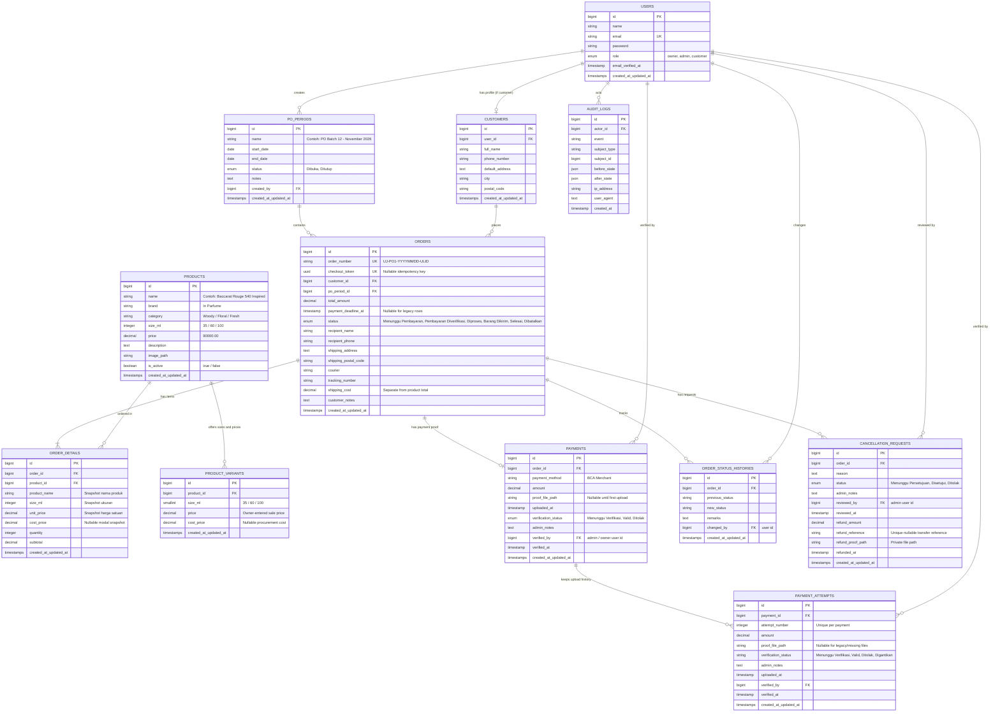

# DATABASE DESIGN SPECIFICATION
## Sistem Informasi Pengelolaan Pre-Order Parfum Berbasis Web - Uyuy Jastip

Pembaruan: 10 November 2026. Dokumen ini mencatat skema yang dibentuk oleh migrasi Laravel pada target MySQL/MariaDB. Kolom `products.size_ml` dan `products.price` tetap dipertahankan untuk kompatibilitas data lama; harga dan ketersediaan ukuran yang digunakan checkout sekarang bersumber dari `product_variants`.

---

### 1. Entitas Utama Berdasarkan Dokumen Proposal
Berdasarkan Dokumen Proposal Capstone Bab II dan Bab III (Subbab 2.2.4 & 3.3), sistem memiliki entitas utama berikut:
1. **Customer**: Menyimpan data identitas pelanggan yang melakukan registrasi dan pemesanan.
2. **Product**: Menyimpan katalog parfum jastip (*In Parfume*).
3. **PO Period**: Menyimpan siklus pre-order yang dibuka dan ditutup oleh Owner.
4. **Order**: Menyimpan transaksi pemesanan yang dibuat oleh Customer dalam suatu periode PO aktif.
5. **Order Detail**: Menyimpan rincian item parfum dan kuantitas dalam satu Order (multi-item support).
6. **Payment**: Menyimpan informasi pembayaran via BCA Merchant dan file bukti transfer yang diverifikasi Admin.
7. **Order Status**: Menyimpan definisi dan tahapan status pesanan yang baku.
8. **Product Variant**: Menyimpan ukuran, harga jual, dan harga modal eksplisit untuk ukuran yang benar-benar tersedia.

#### Tabel Pendukung Teknis (Technical Supporting Tables)
Untuk mendukung integritas, keamanan, dan fungsionalitas sistem sesuai Laravel best practices:
- **`users`**: Tabel otentikasi login, password hash, dan penentuan role (`customer`, `admin`, `owner`). Terhubung 1-to-1 dengan tabel `customers` untuk user ber-role customer.
- **`order_status_histories`**: Audit log setiap perubahan status pesanan lengkap dengan timestamp dan pencatat perubahan (FR-19).
- **`cancellation_requests`**: Entitas khusus penanganan permohonan pembatalan oleh Customer beserta keputusan Admin (FR-14, FR-15).
- **`payment_attempts`**: Riwayat per unggahan bukti dan keputusan verifikasinya; unggahan baru membuat record baru sehingga bukti/keputusan sebelumnya tidak tertimpa saat reupload. File fisik mengikuti kebijakan retensi Owner.
- **`orders.checkout_token`**: UUID unik nullable untuk mencegah retry checkout membuat order/payment duplikat.
- **`audit_logs`**: Catatan aktor, event, subjek, keadaan sebelum/sesudah, IP, dan user agent untuk mutasi penting.

---

### 2. Entity Relationship Diagram (Mermaid)

---

### 3. Rincian Kamus Data (Data Dictionary)

#### A. Tabel `users`
- `id` (BIGINT, PK, Auto Increment)
- `name` (VARCHAR 255): Nama pengguna.
- `email` (VARCHAR 255, Unique): Alamat email untuk login.
- `password` (VARCHAR 255): Password hash bcrypt.
- `role` (ENUM: `'owner'`, `'admin'`, `'customer'`): Hak akses sistem.
- `remember_token` (VARCHAR 100, Nullable).
- `created_at`, `updated_at` (TIMESTAMP).

#### B. Tabel `customers`
- `id` (BIGINT, PK, Auto Increment)
- `user_id` (BIGINT, FK ke `users.id`, On Delete Cascade): Akun pengguna terkait.
- `full_name` (VARCHAR 255): Nama lengkap pelanggan.
- `phone_number` (VARCHAR 30): Nomor WhatsApp / Telepon aktif.
- `default_address` (TEXT, Nullable): Alamat pengiriman lengkap.
- `city` (VARCHAR 100, Nullable): Kota/Kabupaten.
- `postal_code` (VARCHAR 10, Nullable): Kode pos.
- `created_at`, `updated_at` (TIMESTAMP).

#### C. Tabel `po_periods`
- `id` (BIGINT, PK, Auto Increment)
- `name` (VARCHAR 255): Nama periode PO (misal: "PO Batch 10 - Pekan 1").
- `start_date` (DATE): Tanggal mulai pembukaan PO.
- `end_date` (DATE): Tanggal akhir periode PO.
- `status` (ENUM: `'Dibuka'`, `'Ditutup'`): Status operasional PO.
- `notes` (TEXT, Nullable): Keterangan khusus periode PO dari Owner.
- `created_by` (BIGINT, FK ke `users.id`): Owner yang membuat periode PO.
- `created_at`, `updated_at` (TIMESTAMP).

#### D. Tabel `products`
- `id` (BIGINT, PK, Auto Increment)
- `name` (VARCHAR 255): Nama varian parfum.
- `brand` (VARCHAR 100, Default: `'In Parfume'`): Merek/Vendor parfum.
- `category` (VARCHAR 100, Nullable): Kategori aroma (Floral, Woody, Oriental, Fresh, Unisex, dsb).
- `size_ml` (INTEGER): Ukuran legacy/utama yang dipertahankan untuk kompatibilitas.
- `price` (DECIMAL 12,2): Harga legacy/utama yang dipertahankan untuk kompatibilitas. Checkout tidak lagi menghitung harga dari kolom ini.
- `description` (TEXT, Nullable): Catatan aroma (top/middle/base notes) & deskripsi.
- `image_path` (VARCHAR 255, Nullable): Lokasi berkas foto produk.
- `is_active` (BOOLEAN, Default: `true`): Status ketersediaan produk (dikelola Owner).
- `created_at`, `updated_at` (TIMESTAMP).

#### D.1 Tabel `product_variants`
- `id` (BIGINT, PK), `product_id` (BIGINT, FK ke `products.id`, On Delete Cascade).
- `size_ml` (UNSIGNED SMALLINT): Ukuran eksplisit (UI mendukung 35, 60, dan 100 ml).
- `price` (DECIMAL 12,2): Harga jual yang diisi Owner.
- `cost_price` (DECIMAL 12,2, Nullable): Harga modal yang diisi Owner.
- Unique constraint (`product_id`, `size_ml`) mencegah ukuran duplikat untuk satu produk.
- Migrasi hanya membuat satu baris awal dari pasangan `products.size_ml` dan `products.price` lama. Harga ukuran lain tidak ditebak; Owner harus mengisi varian yang memang tersedia.

#### E. Tabel `orders`
- `id` (BIGINT, PK, Auto Increment)
- `order_number` (VARCHAR 64, Unique): Format `UJ-PO{id}-{YYYYMMDD}-{ULID}` untuk menghindari counter checkout bersama.
- `customer_id` (BIGINT, FK ke `customers.id`, On Delete Restrict): Pelanggan pemesan.
- `po_period_id` (BIGINT, FK ke `po_periods.id`, On Delete Restrict): Periode PO tempat pesanan dibuat.
- `total_amount` (DECIMAL 12,2): Total nilai barang pesanan.
- `payment_deadline_at` (TIMESTAMP, Nullable): Tenggat pembayaran; nilai baru mengikuti konfigurasi `PAYMENT_DEADLINE_HOURS`, nilai pesanan lama yang menunggu pembayaran diisi saat migrasi.
- `status` (ENUM: `'Menunggu Pembayaran'`, `'Pembayaran Diverifikasi'`, `'Diproses'`, `'Barang Dikirim'`, `'Selesai'`, `'Dibatalkan'`): Status utama tahapan pesanan.
- `recipient_name` (VARCHAR 255): Nama penerima paket.
- `recipient_phone` (VARCHAR 30): Nomor WhatsApp penerima.
- `shipping_address` (TEXT): Alamat lengkap tujuan pengiriman.
- `shipping_postal_code` (VARCHAR 10, Nullable): Snapshot kode pos tujuan.
- `courier` (VARCHAR 50, Nullable) dan `tracking_number` (VARCHAR 100, Nullable): Data ekspedisi/resi yang diisi Admin sebelum status `Barang Dikirim`.
- `shipping_cost` (DECIMAL 12,2, Default 0): Ongkir yang dicatat Admin; tidak ditambahkan ke `total_amount` atau nominal pembayaran pelanggan pada alur saat ini.
- `customer_notes` (TEXT, Nullable): Catatan khusus pemesan.
- `checkout_token` (UUID, Nullable, Unique): Kunci idempotensi checkout; retry dengan token yang sama mengembalikan pesanan yang sudah dibuat.
- `created_at`, `updated_at` (TIMESTAMP).

#### F. Tabel `order_details`
- `id` (BIGINT, PK, Auto Increment)
- `order_id` (BIGINT, FK ke `orders.id`, On Delete Cascade): Pesanan induk.
- `product_id` (BIGINT, FK ke `products.id`, On Delete Restrict): Produk yang dipesan.
- `product_name` (VARCHAR 255): Menyimpan snapshot nama saat transaksi dibuat.
- `size_ml` (INTEGER): Snapshot ukuran ml saat transaksi.
- `unit_price` (DECIMAL 12,2): Snapshot harga saat transaksi.
- `cost_price` (DECIMAL 12,2, Nullable): Snapshot modal varian saat transaksi dibuat; data historis yang tidak tersedia tetap NULL.
- `quantity` (INTEGER): Jumlah item yang dipesan.
- `subtotal` (DECIMAL 12,2): `unit_price * quantity`.
- `created_at`, `updated_at` (TIMESTAMP).

#### G. Tabel `payments`
- `id` (BIGINT, PK, Auto Increment)
- `order_id` (BIGINT, FK ke `orders.id`, On Delete Cascade): Relasi 1-to-1 dengan `orders`.
- `payment_method` (VARCHAR 100, Default: `'BCA Merchant'`): Metode pembayaran operasional.
- `amount` (DECIMAL 12,2): Jumlah yang dibayarkan.
- `proof_file_path` (VARCHAR 255, Nullable): Path file bukti terbaru; null sebelum unggahan pertama.
- `uploaded_at` (TIMESTAMP, Nullable): Waktu unggah terbaru.
- `verification_status` (ENUM: `'Menunggu Verifikasi'`, `'Valid'`, `'Ditolak'`): Status verifikasi manual Admin.
- `admin_notes` (TEXT, Nullable): Catatan verifikasi Admin (alasan jika ditolak).
- `verified_by` (BIGINT, FK ke `users.id`, Nullable): Admin/Owner yang melakukan verifikasi.
- `verified_at` (TIMESTAMP, Nullable): Waktu tindakan verifikasi dilakukan.
- `created_at`, `updated_at` (TIMESTAMP).

#### H. Tabel `payment_attempts` (riwayat unggahan dan verifikasi)
- `id` (BIGINT, PK, Auto Increment)
- `payment_id` (BIGINT, FK ke `payments.id`, On Delete Cascade)
- `attempt_number` (INTEGER UNSIGNED): Nomor urut unik per payment.
- `amount` (DECIMAL 12,2): Nominal yang dilaporkan untuk percobaan ini.
- `proof_file_path` (VARCHAR 255, Nullable): Path bukti privat atau path legacy yang belum dipindahkan.
- `verification_status` (VARCHAR 32): `Menunggu Verifikasi`, `Valid`, `Ditolak`, atau `Digantikan`.
- `admin_notes` (TEXT, Nullable): Alasan penolakan atau catatan verifikasi/rekonsiliasi.
- `uploaded_at` (TIMESTAMP, Nullable), `verified_by` (BIGINT, FK ke `users.id`, Nullable, On Delete Set Null), dan `verified_at` (TIMESTAMP, Nullable).
- Unique constraint: (`payment_id`, `attempt_number`); index: (`payment_id`, `verification_status`). Data bukti yang telah ada di-backfill sebagai attempt pertama saat migration.
- `created_at`, `updated_at` (TIMESTAMP).

#### I. Tabel `order_status_histories`
- `id` (BIGINT, PK, Auto Increment)
- `order_id` (BIGINT, FK ke `orders.id`, On Delete Cascade): Pesanan terkait.
- `previous_status` (VARCHAR 64, Nullable): Status sebelumnya.
- `new_status` (VARCHAR 64): Status baru yang diterapkan.
- `remarks` (TEXT, Nullable): Catatan keterangan perubahan.
- `changed_by` (BIGINT, FK ke `users.id`, Nullable, On Delete Set Null): User yang memperbarui status.
- `created_at`, `updated_at` (TIMESTAMP).

#### J. Tabel `cancellation_requests`
- `id` (BIGINT, PK, Auto Increment)
- `order_id` (BIGINT, FK ke `orders.id`, On Delete Cascade): Pesanan yang diajukan pembatalan.
- `reason` (TEXT): Alasan Customer mengajukan pembatalan pesanan.
- `status` (ENUM: `'Menunggu Persetujuan'`, `'Disetujui'`, `'Ditolak'`): Keputusan Admin.
- `admin_notes` (TEXT, Nullable): Keterangan keputusan dari Admin.
- `reviewed_by` (BIGINT, FK ke `users.id`, Nullable): Admin yang mengambil keputusan.
- `reviewed_at` (TIMESTAMP, Nullable): Waktu pengambilan keputusan.
- `refund_amount` (DECIMAL 12,2, Nullable): Nilai pengembalian untuk pembatalan order berbayar.
- `refund_reference` (VARCHAR 100, Nullable, Unique): Referensi transfer refund yang dicatat Admin.
- `refund_proof_path` (VARCHAR 255, Nullable): Lokasi privat bukti refund.
- `refunded_at` (TIMESTAMP, Nullable): Waktu refund dicatat selesai.
- `created_at`, `updated_at` (TIMESTAMP).

#### K. Tabel `audit_logs`
- `id` (BIGINT, PK); `actor_id` (BIGINT, FK ke `users.id`, On Delete Set Null).
- `event` (VARCHAR 100), `subject_type` (VARCHAR 150), dan `subject_id` (UNSIGNED BIGINT): Jenis mutasi dan record terkait.
- `before_state`, `after_state` (JSON, Nullable): Snapshot terbatas sebelum/sesudah mutasi.
- `ip_address` (VARCHAR 45, Nullable), `user_agent` (TEXT, Nullable), dan `created_at` (TIMESTAMP).
- Index: (`subject_type`, `subject_id`), (`actor_id`, `created_at`), dan (`event`, `created_at`).

---

### 4. Integritas Relasi & Aturan Bisnis Basis Data
1. **Pemisahan Kewenangan**:
   - Kolom `po_periods.created_by` hanya dapat diisi oleh user ber-role `'owner'`.
   - Update `po_periods.status` hanya diizinkan untuk user `'owner'`.
   - Kolom `payments.verified_by` dan `cancellation_requests.reviewed_by` mencatat user Admin/Owner yang bertindak secara nyata (audit trail).
2. **Ketergantungan Pesanan**:
   - Penghapusan produk master tidak akan merusak riwayat transaksi karena tabel `order_details` menyimpan snapshot (`product_name`, `size_ml`, `unit_price`).
3. **Data Isolation Customer**:
   - Setiap query pesanan milik customer selalu difilter `WHERE customer_id = ?` dan divalidasi melalui Policy otorisasi backend.

### 5. Skema Aktual, Indeks, dan Perbedaan dari Rancangan Awal

- Relasi customer ke user dijaga unique pada `customers.user_id`; order membatasi penghapusan customer dan PO (`RESTRICT`), sementara detail order, payment, permohonan pembatalan, dan varian produk mengikuti penghapusan parent melalui `CASCADE` sesuai migrasi masing-masing.
- Indeks query mencakup status PO, produk aktif/tanggal, order per customer/tanggal, order per PO/status, order per status/tanggal, detail order/produk, status pembayaran/tanggal, waktu unggah pembayaran, riwayat status/order, dan status permohonan pembatalan/tanggal.
- Indeks operasional tambahan mencakup `orders(status, payment_deadline_at)`, `orders.checkout_token` unik, pasangan unik `product_variants(product_id, size_ml)`, pasangan unik `payment_attempts(payment_id, attempt_number)`, referensi refund unik, dan index event/subjek audit.
- `products.size_ml` dan `products.price` masih ada di skema fisik. Keduanya adalah kolom kompatibilitas untuk data legacy; seluruh harga checkout harus berasal dari varian yang disimpan secara eksplisit.
- `orders.total_amount` menghitung nilai produk saja. `shipping_cost` dicatat terpisah dan saat ini tidak masuk ke tagihan pembayaran; kebijakan apakah ongkir ditagih pelanggan masih keputusan operasional di luar implementasi sekarang.
- Modal historis tidak dapat dipulihkan dari migrasi: `order_details.cost_price` untuk order lama tetap NULL dan harus ditafsirkan sebagai data modal tidak tersedia, bukan nol.
- Status order tetap disimpan sebagai ENUM MySQL sesuai migrasi awal; timestamp disimpan sebagai TIMESTAMP, nominal menggunakan DECIMAL(12,2), kode pos sebagai string, dan payload audit memakai JSON.
- Migrasi 10 November 2026 sudah diterapkan pada database lokal setelah membuat backup privat. Verifikasi agregat: 15 produk dan 15 varian hasil backfill, 0 produk tanpa varian, 0 order menunggu pembayaran tanpa deadline, 7 pembayaran dengan bukti dan 7 payment attempt, serta 0 bukti terbaru yang tidak punya attempt terkait.
- Satu order lama tidak memiliki row `order_status_histories`. Migrasi tidak membuat riwayat buatan karena status sebelumnya/waktu transisi tidak diketahui; perlu ditinjau terhadap sumber transaksi sebelum ditambahkan catatan manual.

Migrasi skema terkait:

1. `2026_11_06_000001_add_order_query_indexes.php`
2. `2026_11_07_000001_add_checkout_idempotency_and_payment_attempts.php`
3. `2026_11_10_000001_add_product_variants_and_order_operations.php`
4. `2026_11_10_000002_add_refund_tracking_to_cancellation_requests.php`
5. `2026_11_10_000003_create_audit_logs_table.php`

