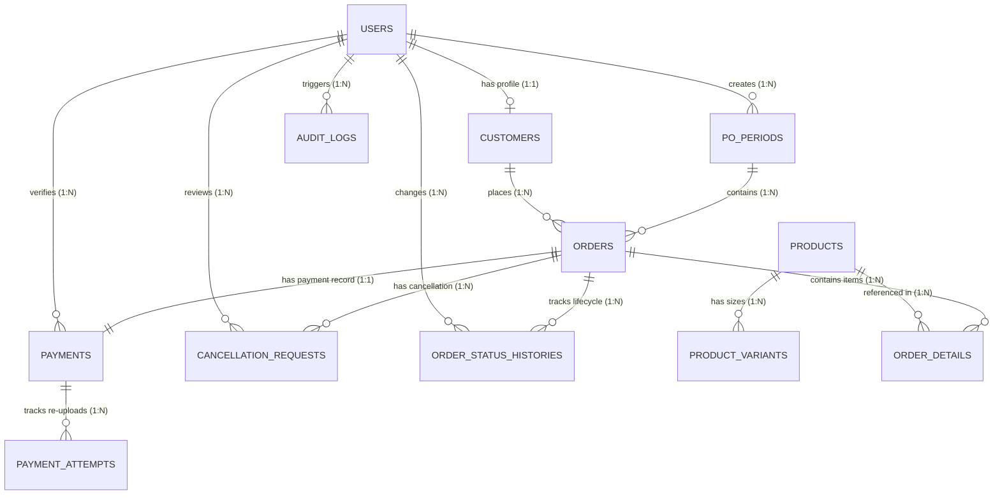

# Project Structure & Component Inventory
## Uyuy Jastip — Sistem Informasi Pengelolaan Pre-Order Parfum Berbasis Web

- **Document Version:** 1.0 (Phase 1 Technical Audit)
- **Target Project:** Capstone Project Sistem Informasi — Telkom University
- **Framework:** Laravel 12.71.0 / PHP 8.2.12 / Vite 6.0.11 / Bootstrap 5.3.3
- **Audit Date:** 13 November 2026
- **Status:** READ-ONLY DISCOVERY COMPLETE

---

## 1. Directory Tree & Architecture Overview

```
e:\Codex
├── app/
│   ├── Actions/                    # Domain action services (Single Responsibility)
│   │   ├── CreateOrderAction.php
│   │   ├── DecideCancellationAction.php
│   │   └── VerifyPaymentAction.php
│   ├── Console/Commands/           # Scheduled maintenance & CLI commands
│   │   ├── BackupDatabase.php
│   │   ├── CancelExpiredOrders.php
│   │   └── SecurePaymentProofs.php
│   ├── Http/
│   │   ├── Controllers/            # Route controllers partitioned by role
│   │   │   ├── Admin/              # Operational controller namespace
│   │   │   │   ├── CancellationController.php
│   │   │   │   ├── DashboardController.php
│   │   │   │   ├── OrderController.php
│   │   │   │   └── PaymentController.php
│   │   │   ├── Auth/               # Self-service authentication controllers
│   │   │   │   ├── NewPasswordController.php
│   │   │   │   └── PasswordResetLinkController.php
│   │   │   ├── Customer/           # Storefront customer portal controllers
│   │   │   │   ├── CartController.php
│   │   │   │   ├── DashboardController.php
│   │   │   │   └── OrderController.php
│   │   │   ├── Owner/              # Business owner executive controllers
│   │   │   │   ├── CustomerController.php
│   │   │   │   ├── DashboardController.php
│   │   │   │   ├── PoPeriodController.php
│   │   │   │   ├── ProductController.php
│   │   │   │   └── RecapController.php
│   │   │   ├── AuthController.php
│   │   │   ├── CatalogController.php
│   │   │   ├── Controller.php
│   │   │   ├── HomeController.php
│   │   │   ├── PaymentProofController.php
│   │   │   ├── PoInfoController.php
│   │   │   ├── ProductDetailController.php
│   │   │   └── RefundProofController.php
│   │   ├── Middleware/
│   │   │   ├── CheckRole.php       # Role-Based Access Control enforcement
│   │   │   └── SecurityHeaders.php # HTTP Security Headers & strict CSP
│   │   └── Requests/               # FormRequest validation classes
│   │       ├── Admin/
│   │       │   ├── DecideCancellationRequest.php
│   │       │   └── VerifyPaymentRequest.php
│   │       ├── CheckoutRequest.php
│   │       └── RegisterRequest.php
│   ├── Models/                     # Eloquent entities & relationships
│   │   ├── AuditLog.php
│   │   ├── CancellationRequest.php
│   │   ├── Customer.php
│   │   ├── Order.php
│   │   ├── OrderDetail.php
│   │   ├── OrderStatusHistory.php
│   │   ├── Payment.php
│   │   ├── PaymentAttempt.php
│   │   ├── PoPeriod.php
│   │   ├── Product.php
│   │   ├── ProductVariant.php
│   │   └── User.php
│   ├── Policies/                   # Authorization policies
│   │   └── OrderPolicy.php
│   ├── Providers/
│   │   └── AppServiceProvider.php
│   └── Support/                    # Value objects & format helpers
│       ├── IndonesianPhone.php
│       └── Money.php
├── bootstrap/
│   ├── app.php                     # Laravel 12 application bootstrapper
│   └── providers.php
├── config/                         # Application settings
│   ├── app.php
│   ├── auth.php
│   ├── backup.php                  # Database backup settings
│   ├── cache.php
│   ├── database.php
│   ├── filesystems.php             # Private/Public storage setup
│   ├── jastip.php                  # Merchant bank details & policies
│   ├── logging.php
│   ├── mail.php
│   ├── queue.php
│   ├── services.php
│   └── session.php
├── database/
│   ├── factories/
│   ├── migrations/                 # 16 schema migrations
│   └── seeders/
│       └── DatabaseSeeder.php      # Production-guarded seed dataset
├── docs/                           # Architecture, audit, and runbook docs
├── public/                         # Web server root
│   ├── build/                      # Vite manifest & hashed assets
│   ├── images/
│   ├── index.php                   # Single entry point
│   └── robots.txt
├── resources/
│   ├── css/
│   │   ├── app.css
│   │   └── uyuy-theme.css          # Editorial Stone v2 design system
│   ├── js/
│   │   ├── app.js                  # Centralized vanilla JS behaviors
│   │   └── bootstrap.js
│   └── views/                      # 51 Blade templates
│       ├── admin/                  # 7 operational templates
│       ├── auth/                   # 4 authentication templates
│       ├── components/             # 13 shared UI components
│       ├── customer/               # 6 customer portal templates
│       ├── errors/                 # 5 standalone error templates
│       ├── layouts/                # 3 role shell layouts
│       ├── owner/                  # 9 executive templates
│       └── pages/                  # 4 public storefront templates
├── routes/
│   ├── console.php                 # Scheduled artisan tasks
│   └── web.php                     # 53 web route definitions
├── storage/
│   └── app/
│       ├── private/                # Private payment proofs & backups
│       └── public/                 # Public product images
└── tests/
    ├── Feature/                    # 5 Feature test classes (31 tests)
    └── Unit/                       # 1 Unit test class
```

---

## 2. Technology Stack Inventory

| Component / Layer | Technology / Package | Version Identified | Status & Verification |
|---|---|---|---|
| **Runtime Environment** | PHP CLI (ZTS x64) | `8.2.12` | Verified via `php -v` |
| **Backend Framework** | Laravel Framework | `12.71.0` | Verified via `artisan --version` |
| **Database Engine** | MySQL / MariaDB (Local/Prod), SQLite (In-Memory Testing) | MySQL 8.0+ / SQLite 3 | Verified via `database.php` & `phpunit.xml` |
| **Frontend Templating** | Laravel Blade Engine | Built-in | 51 templates verified |
| **CSS Framework** | Bootstrap | `5.3.3` (SRI CDN in layout) | Verified via layout `<link>` tags |
| **Custom Styling** | Editorial Stone v2 (`uyuy-theme.css`) | Local CSS bundle | Verified via `resources/css/uyuy-theme.css` |
| **JavaScript Pipeline** | Native ECMAScript (Vanilla JS) | ES2022+ | Verified via `resources/js/app.js` |
| **Build Tooling** | Vite + Laravel Vite Plugin | Vite `6.4.5` / Plugin `1.2.0` | Verified via `npm run build` |
| **Testing Suite** | PHPUnit | `11.5.57` | 31 tests / 256 assertions passed |
| **Task Scheduler** | Laravel Scheduler (`schedule:run`) | Built-in | Verified in `routes/console.php` |
| **Backup Utility** | `mysqldump` / gzip compression | Local binary | Verified in `app/Console/Commands/BackupDatabase.php` |

---

## 3. Database Entities & Relationship Map



### Table Schema Summary

1. **`users`**: Authentication table with RBAC discriminator (`role`: `'customer'`, `'admin'`, `'owner'`).
2. **`customers`**: Profile metadata for customer role (`user_id` unique, `full_name`, `phone_number`, `default_address`, `city`, `postal_code`).
3. **`po_periods`**: PO cycles with strict WIB date checking (`start_date`, `end_date`, `status`: `'Dibuka'`, `'Ditutup'`).
4. **`products`**: Master product variants (`name`, `brand`, `category`, `image_path`, `is_active`).
5. **`product_variants`**: Size-based pricing tiers (`size_ml`, `price`, `cost_price` for Owner procurement calculation).
6. **`orders`**: Core transaction table (`order_number`, `checkout_token` UUID, `customer_id`, `po_period_id`, `total_amount`, `payment_deadline_at`, `status`, recipient & courier data).
7. **`order_details`**: Line items snapshotting product, size, unit price, cost price, and quantity at purchase time.
8. **`payments`**: Transaction settlement tracking (`order_id` unique, `amount`, `proof_file_path`, `verification_status`: `'Menunggu Verifikasi'`, `'Valid'`, `'Ditolak'`).
9. **`payment_attempts`**: Audit trail of repeated payment proof uploads (`payment_id`, `attempt_number`, `amount`, `proof_file_path`, `verification_status`).
10. **`order_status_histories`**: Immutable log of order lifecycle state changes (`order_id`, `previous_status`, `new_status`, `remarks`, `changed_by`).
11. **`cancellation_requests`**: Cancellation workflow (`order_id`, `reason`, `status`, `refund_amount`, `refund_reference`, `refund_proof_path`, `refunded_at`).
12. **`audit_logs`**: Financial and administrative change ledger (`actor_id`, `event`, `subject_type`, `subject_id`, `before_state`, `after_state`, `ip_address`, `user_agent`).

---

## 4. Route Inventory & Role Matrix

Total active routes: **53 routes** (excluding framework vendor routes).

| Prefix / Group | URI Path | HTTP Method | Controller Action | Name | Access Role |
|---|---|---|---|---|---|
| **Public** | `/` | GET | `HomeController@index` | `home` | Guest / All |
| | `/katalog` | GET | `CatalogController@index` | `catalog` | Guest / All |
| | `/produk/{id}` | GET | `ProductDetailController@show` | `product.detail` | Guest / All |
| | `/informasi-po` | GET | `PoInfoController@index` | `po.info` | Guest / All |
| **Auth** | `/login` | GET/POST | `AuthController@showLogin / login` | `login` / `login.post` | Guest (Throttle 5/1) |
| | `/register` | GET/POST | `AuthController@showRegister / register` | `register` / `register.post` | Guest (Throttle 5/1) |
| | `/forgot-password` | GET/POST | `PasswordResetLinkController` | `password.request` / `.email` | Guest (Throttle 3/1) |
| | `/reset-password/{token}` | GET/POST | `NewPasswordController` | `password.reset` / `.update` | Guest (Throttle 5/1) |
| | `/logout` | POST | `AuthController@logout` | `logout` | Authenticated |
| **Secure Files** | `/pembayaran/{payment}/bukti` | GET | `PaymentProofController@show` | `payments.proof` | Authenticated + Policy |
| | `/pembayaran/percobaan/{attempt}/bukti` | GET | `PaymentProofController@showAttempt` | `payments.attempt-proof` | Authenticated + Policy |
| | `/pembatalan/{cancellation}/bukti-refund` | GET | `RefundProofController@show` | `cancellations.refund-proof` | Authenticated + Policy |
| **Customer** | `/pelanggan/dashboard` | GET | `Customer\DashboardController@index` | `customer.dashboard` | Customer |
| | `/pelanggan/keranjang` | GET | `Customer\CartController@index` | `customer.cart` | Customer |
| | `/pelanggan/keranjang/tambah` | POST | `Customer\CartController@add` | `customer.cart.add` | Customer |
| | `/pelanggan/keranjang/{key}` | PUT | `Customer\CartController@update` | `customer.cart.update` | Customer |
| | `/pelanggan/keranjang/hapus/{key}` | POST | `Customer\CartController@remove` | `customer.cart.remove` | Customer |
| | `/pelanggan/checkout` | POST | `Customer\CartController@checkout` | `customer.checkout.post` | Customer |
| | `/pelanggan/pesanan` | GET | `Customer\OrderController@index` | `customer.orders.index` | Customer |
| | `/pelanggan/pesanan/{id}` | GET | `Customer\OrderController@show` | `customer.orders.show` | Customer + Policy |
| | `/pelanggan/pesanan/{id}/pembayaran` | GET/POST | `Customer\OrderController@payment / uploadPayment` | `customer.orders.payment` | Customer + Policy |
| | `/pelanggan/pesanan/{id}/batal` | GET/POST | `Customer\OrderController@cancellation / submitCancellation` | `customer.orders.cancellation` | Customer + Policy |
| **Admin** | `/admin/dashboard` | GET | `Admin\DashboardController@index` | `admin.dashboard` | Admin, Owner |
| | `/admin/pesanan` | GET | `Admin\OrderController@index` | `admin.orders.index` | Admin, Owner |
| | `/admin/pesanan/{id}` | GET | `Admin\OrderController@show` | `admin.orders.show` | Admin, Owner |
| | `/admin/pesanan/{id}/status` | POST | `Admin\OrderController@updateStatus` | `admin.orders.status.update` | Admin, Owner |
| | `/admin/pembayaran` | GET | `Admin\PaymentController@index` | `admin.payments.index` | Admin, Owner |
| | `/admin/pembayaran/{id}/verifikasi` | GET/POST | `Admin\PaymentController@verify / processVerification` | `admin.payments.verify` | Admin, Owner |
| | `/admin/pembatalan` | GET | `Admin\CancellationController@index` | `admin.cancellations.index` | Admin, Owner |
| | `/admin/pembatalan/{id}` | GET | `Admin\CancellationController@show` | `admin.cancellations.show` | Admin, Owner |
| | `/admin/pembatalan/{id}/putusan` | POST | `Admin\CancellationController@decide` | `admin.cancellations.decide.post` | Admin, Owner |
| **Owner** | `/owner/dashboard` | GET | `Owner\DashboardController@index` | `owner.dashboard` | Owner |
| | `/owner/periode-po` | GET | `Owner\PoPeriodController@index` | `owner.po-periods.index` | Owner |
| | `/owner/periode-po/tambah` | GET/POST | `Owner\PoPeriodController@create / store` | `owner.po-periods.create` / `.store` | Owner |
| | `/owner/periode-po/{id}/edit` | GET/PUT | `Owner\PoPeriodController@edit / update` | `owner.po-periods.edit` / `.update` | Owner |
| | `/owner/periode-po/{id}/status` | POST | `Owner\PoPeriodController@toggleStatus` | `owner.po-periods.status.toggle` | Owner |
| | `/owner/produk` | GET | `Owner\ProductController@index` | `owner.products.index` | Owner |
| | `/owner/produk/tambah` | GET/POST | `Owner\ProductController@create / store` | `owner.products.create` / `.store` | Owner |
| | `/owner/produk/{id}/edit` | GET/PUT | `Owner\ProductController@edit / update` | `owner.products.edit` / `.update` | Owner |
| | `/owner/produk/{id}/toggle` | POST | `Owner\ProductController@toggle` | `owner.products.toggle` | Owner |
| | `/owner/rekapitulasi` | GET | `Owner\RecapController@index` | `owner.recap.index` | Owner |
| | `/owner/pelanggan` | GET | `Owner\CustomerController@index` | `owner.customers.index` | Owner |

---

## 5. View & Component Inventory (51 Blade Files)

### Shared Layouts (3)
1. `resources/views/layouts/app.blade.php`: Public storefront & Customer portal shell (`.navbar-uyuy`, `.footer-uyuy`, Vite assets).
2. `resources/views/layouts/admin.blade.php`: Admin operational workspace shell (`.role-topbar`, `.role-sidebar` sticky, container `1480px`).
3. `resources/views/layouts/owner.blade.php`: Owner executive workspace shell (`.role-topbar` Soot, `.role-sidebar` sticky, container `1480px`).

### Shared Components (13)
1. `components/navbar.blade.php`: Storefront top header (`76px`) with brand, catalog link, cart badge, and auth buttons.
2. `components/footer.blade.php`: Clean footer with customer service hours, legal notices, and configured social links.
3. `components/sidebar-admin.blade.php`: 3-zone sticky operational sidebar with profile card, active route states, authority note, and pinned logout.
4. `components/sidebar-owner.blade.php`: 3-zone sticky executive sidebar with Owner badge, PO/Product/Recap/Customer links, and pinned logout.
5. `components/customer-portal-nav.blade.php`: Horizontal tab strip for Customer dashboard, orders, cart, and catalog.
6. `components/button.blade.php`: Base button component with size and color variants.
7. `components/card.blade.php`: Base container card with Editorial Stone border and padding.
8. `components/input.blade.php`: Standardized input field wrapper with label and error feedback.
9. `components/product-card.blade.php`: 1:1 image ratio product card with starting price and available sizes.
10. `components/status-badge.blade.php`: Semantic status badge for order and PO states.
11. `components/order-timeline.blade.php`: 5-step order progress stepper (horizontal on desktop, vertical on mobile).
12. `components/flash-messages.blade.php`: Unified session alert renderer (`success`, `error`, `warning`, `info`).
13. `components/demo-badge.blade.php`: Environment-gated badge for demo credential helpers.

### Pages & Sub-systems (35)
- **Public (4):** `home`, `catalog`, `product-detail`, `po-info`
- **Auth (4):** `login`, `register`, `forgot-password`, `reset-password`
- **Customer Portal (6):** `dashboard`, `cart`, `orders/index`, `orders/show`, `orders/payment`, `orders/cancellation`
- **Admin Workspace (7):** `dashboard`, `orders/index`, `orders/show`, `payments/index`, `payments/verify`, `cancellations/index`, `cancellations/show`
- **Owner Workspace (9):** `dashboard`, `po-periods/index`, `po-periods/create`, `po-periods/edit`, `products/index`, `products/create`, `products/edit`, `recap/index`, `customers/index`
- **Error Views (5):** `errors/layout`, `403`, `404`, `419`, `500` (Zero-database dependency, CSP compliant)

